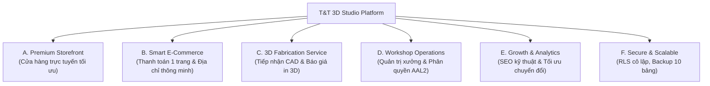

# CHIẾN LƯỢC & TẦM NHÌN SẢN PHẨM (PRODUCT VISION & STRATEGY)
## NỀN TẢNG THƯƠNG MẠI ĐIỆN TỬ & DỊCH VỤ CHẾ TÁC SỐ T&T 3D STUDIO

**Tài liệu tham chiếu:** `LO_TRINH_PHAT_TRIEN_TT_3D.md` • `reports/TRANSFORMATION_BASELINE_AUDIT.md`  
**Ngày ban hành:** 02/11/2026  
**Chủ trì:** Principal AI Engineering Agent & Ecommerce Product Strategist  

---

## 1. TẦM NHÌN SẢN PHẨM (PRODUCT VISION)

> **T&T 3D Studio** là nền tảng thương mại điện tử kết hợp xưởng chế tác số (Digital Fabrication Atelier) tiên phong tại miền Trung Việt Nam (trụ sở tại Hà Tĩnh), chuyên cung cấp các sản phẩm decor thông minh, phụ kiện bàn làm việc cá nhân hóa, và dịch vụ in 3D kỹ thuật cao cho khách hàng cá nhân và doanh nghiệp trên toàn quốc.

### Sự khác biệt cốt lõi (Core Differentiation):
1. **Sản phẩm ứng dụng thực tế cao:** Không in mô hình đồ chơi vô bổ; tập trung vào vật phẩm giải quyết nhu cầu đời sống (Đế WiFi/NFC chạm cho quán cà phê, ống cắm bút/cọ coquette, đèn decor khuếch tán ánh sáng ấm, khay xếp chồng ngàm khóa module).
2. **Quy trình chế tác thủ công chuẩn mực (Artisan Craftsmanship):** Ứng dụng dàn máy Bambu Lab cao cấp, nhựa nguyên sinh sinh học Bio-PLA & PETG chống tia UV, độ dày lớp in tiêu chuẩn 0.16mm (và tùy chọn 0.08mm siêu mịn cho tượng điêu khắc).
3. **Trải nghiệm mua hàng 1 chạm:** Tối giản quy trình thanh toán với One-Page Checkout, tự động điền địa chỉ 2 cấp hành chính thông minh, miễn phí vận chuyển toàn quốc cho đơn từ 300.000 đ.

---

## 2. CHÂN DUNG KHÁCH HÀNG MỤC TIÊU (TARGET AUDIENCE PERSONAS)

| Nhóm khách hàng | Đặc điểm & Nhu cầu chính | Sản phẩm / Dịch vụ chủ lực | Giá trị kỳ vọng |
| :--- | :--- | :--- | :--- |
| **1. Khách mua Decor & Quà tặng cá nhân** | Giới trẻ, nhân viên văn phòng, người thích trang trí góc làm việc, phong cách Coquette, Minimalist, Cyberpunk. | Bình hoa xếp nếp, Ống cắm cọ nơ lụa, Đèn ngủ quả đào, Hộp bánh xe Ferris. | Đẹp, độc đáo, không đụng hàng, bao bì đóng gói chuẩn hộp quà, giao nhanh. |
| **2. Quán Cà phê, Khách sạn, Homestay** | Chủ cơ sở kinh doanh cần giải pháp chuyên nghiệp hóa quầy thu ngân và bàn phục vụ. | Đế WiFi NFC Chạm Thông Minh, Biển mã QR thanh toán hai mặt, Bảng số bàn decor. | Bền bỉ, chống nước, khắc logo thương hiệu riêng, chip NFC bảo hành trọn đời không cần pin. |
| **3. Khách hàng Cá nhân hóa (Custom Gift)** | Người tìm quà tặng sinh nhật, kỷ niệm, vinh danh có khắc tên hoặc thông điệp riêng. | Biển tên để bàn dập nổi chữ vàng, Móc khóa Monogram 3D, Đèn phát quang khắc chữ. | Nhập tên trực quan trên web, thấy trước bản phối màu, độ hoàn thiện tinh xảo. |
| **4. Kỹ sư, Sinh viên & Doanh nghiệp** | Cần in mẫu thử (Prototyping), đồ gá lắp (Jig & Fixture), vỏ hộp điện tử, chi tiết cơ khí. | Cổng tiếp nhận file CAD (STL/STEP), in nhựa PETG chịu lực, Nylon PA12, Resin 8K. | Báo giá nhanh, phân tích slicer chính xác, bảo mật bản vẽ CAD, độ chính xác kích thước $\pm 0.1\text{mm}$. |

---

## 3. MA TRẬN 6 NĂNG LỰC CỐT LÕI (THE 6 PILLARS)

---

## 4. CHIẾN LƯỢC SẢN PHẨM & QUẢN TRỊ BẢN QUYỀN (IP & CATALOG STRATEGY)

Để khắc phục rủi ro bản quyền thương mại đối với 105 mẫu MakerWorld (`FINDING-BIZ-03`), T&T 3D Studio áp dụng chiến lược tái cấu trúc danh mục theo 3 tầng:

1. **Tầng 1: Bộ sưu tập Độc quyền (T&T Originals - 30%):**
   * Các sản phẩm do xưởng tự dựng CAD và đăng ký nhãn hiệu: Biển tên để bàn cao cấp, Đế WiFi NFC chạm thông minh, Giá đỡ tai nghe module, Bảng số bàn quán cà phê.
   * Toàn quyền thương mại, đẩy mạnh làm sản phẩm mỏ neo (Anchor Products).
2. **Tầng 2: Mẫu Hợp tác & Creative Commons Commercial (Licensed - 40%):**
   * Tuyển chọn các tác phẩm từ MakerWorld/Printables có giấy phép CC-BY hoặc tham gia chương trình Commercial Membership của các nhà thiết kế gốc.
   * Ghi rõ nguồn tác giả và giấy phép minh bạch trên trang chi tiết sản phẩm.
3. **Tầng 3: Dịch vụ In Gia công Theo Yêu Cầu (Custom Fabrication - 30%):**
   * Khách hàng tự cung cấp liên kết tải file hoặc tải lên file cá nhân.
   * Xưởng tính phí gia công in 3D và vật liệu (Print-on-demand Service), không kinh doanh bán lẻ file số.
