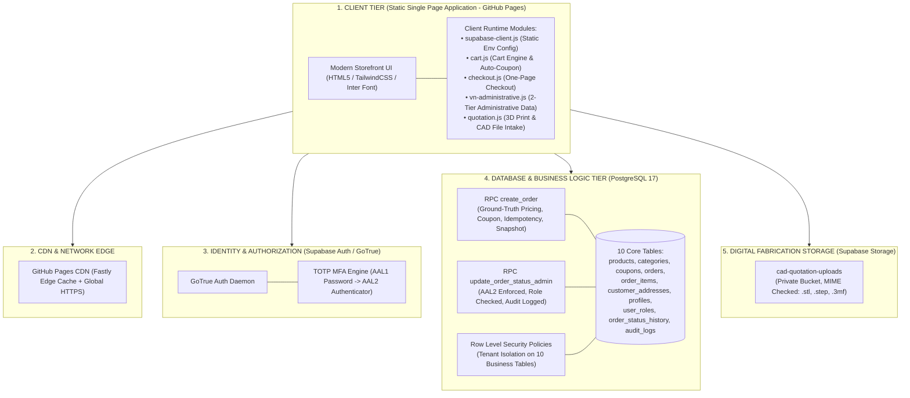

# TÀI LIỆU THIẾT KẾ KIẾN TRÚC MỤC TIÊU (TARGET ARCHITECTURE)
## ĐÁNH GIÁ CHIẾN LƯỢC CÔNG NGHỆ & ĐẶC TẢ KIẾN TRÚC HỆ THỐNG T&T 3D STUDIO

**Tài liệu tham chiếu:** `reports/TRANSFORMATION_BASELINE_AUDIT.md` • `LO_TRINH_PHAT_TRIEN_TT_3D.md`  
**Ngày ban hành:** 02/11/2026  
**Chủ trì:** Principal AI Engineering Agent & Software Architect  

---

## 1. SO SÁNH HAI PHƯƠNG ÁN KIẾN TRÚC (TRADE-OFF ANALYSIS)

Dựa trên kết quả kiểm toán Phase 0, dự án đang tồn tại hai nhánh kiến trúc: Hệ thống Static SPA hiện hữu trên GitHub Pages và Bản thử nghiệm Next.js 14 trong thư mục `src/`. Dưới đây là ma trận phân tích đối sánh chi tiết:

| Tiêu chí so sánh | Phương án A: Tiến hóa nền tảng hiện hữu (Evolutionary Upgrade)<br>*(Vanilla Modern SPA + Supabase Serverless + GitHub Pages)* | Phương án B: Đại phẫu di chuyển (Full Migration to Next.js)<br>*(Next.js 14 App Router + Vercel Hosting + SSR)* |
| :--- | :--- | :--- |
| **1. Chi phí vận hành (Cost)** | **0 đ / tháng.** GitHub Pages miễn phí 100% băng thông; Supabase Free/Pro tier tối ưu hóa query. | Tăng thêm từ 20$ – 40$/tháng (Vercel Pro + Serverless Functions execution time + Database compute). |
| **2. Độ phức tạp (Complexity)** | **Thấp - Trung bình.** Mã nguồn trực quan, chạy trực tiếp trên trình duyệt, không cần build step phức tạp hay Node.js server. | **Rất cao.** Phải viết lại 100% logic thanh toán, sổ địa chỉ 2 cấp, modal chi tiết, auth session sang React hooks và state management. |
| **3. Hiệu năng tải trang (Performance)** | **Xuất sắc.** File HTML/CSS/JS tĩnh phân phối qua Fastly/GitHub CDN toàn cầu; FCP và TTFB cực thấp do không có SSR latency. | Khá. SSR có thể làm tăng TTFB ở Việt Nam nếu serverless edge đặt tại Singapore/Mỹ. |
| **4. Độ an toàn bảo mật (Security)** | **Rất cao.** Toàn bộ bảo mật, phân quyền và tính toán giá ground-truth được thực thi tại Database PostgreSQL (RLS + SECURITY DEFINER RPC). Client hoàn toàn không có secret key. | Tương đương. Cần bảo mật thêm các Server Actions và API Routes chống injection. |
| **5. Khả năng SEO** | **Khá.** Với GitHub Pages tĩnh, các thẻ meta và structured data JSON-LD có thể render sẵn trong `index.html`. Hạn chế nếu có hàng nghìn trang động. | **Xuất sắc.** Next.js hỗ trợ SSR/SSG sinh dynamic metadata per-product tự động. |
| **6. Khả năng bảo trì (Maintainability)** | Tốt nếu modular hóa các file JS thành các service riêng biệt, loại bỏ dead code. | Tốt cho đội ngũ chuyên React/TypeScript, nhưng đòi hỏi cập nhật dependencies thường xuyên. |
| **7. Rủi ro chuyển đổi (Migration Risk)** | **Rất thấp (Gần như bằng 0).** Hoạt động liên tục, không gây gián đoạn đơn hàng, khả năng rollback tức thì qua Git. | **Cực kỳ cao.** Nguy cơ phát sinh hàng loạt lỗi hồi quy (regressions) ở luồng đặt hàng và phân quyền RLS đã được nghiệm thu. |

---

## 2. QUYẾT ĐỊNH KIẾN TRÚC CHÍNH THỨC (ARCHITECTURAL DECISION)

> [!IMPORTANT]
> **KẾT LUẬN LỰA CHỌN: PHƯƠNG ÁN A (EVOLUTIONARY UPGRADE)**
> 
> Ban Kỹ thuật quyết định lựa chọn **Phương án A — Tiến hóa nền tảng hiện hữu**:
> 1. Bảo vệ thành quả của toàn bộ hệ thống kiểm thử RLS, One-Page Checkout và MFA AAL2 đã hoàn thiện.
> 2. Giữ nguyên chi phí hosting bằng 0 trên GitHub Pages, tối ưu hóa ngân sách vận hành cho xưởng.
> 3. Tiến hành tái cấu trúc (refactor) mã nguồn client theo hướng module hóa rõ ràng, gỡ bỏ toàn bộ dead code và tối ưu hóa SEO bằng JSON-LD Schema.
> 4. Đóng băng thư mục `src/` thành kho tham khảo component UI, không tiêu tốn tài nguyên vào việc viết lại từ đầu.

---

## 3. SƠ ĐỒ KIẾN TRÚC MỤC TIÊU (TARGET ARCHITECTURE DIAGRAM)



---

## 4. CHI TIẾT CÁC THÀNH PHẦN KIẾN TRÚC MỤC TIÊU

### 4.1. Cấu hình Môi trường Đóng băng (Immutable Build Configuration)
* Sử dụng file `js/env-config.js` cố định tại thời điểm build:
  ```javascript
  window.TT_ENV = Object.freeze({
    ENV_NAME: 'production', // hoặc 'staging'
    SUPABASE_URL: 'https://nbsumfhfxohawiuxrwqj.supabase.co',
    SUPABASE_ANON_KEY: '...',
    IS_LOCKED: true
  });
  ```
* Tuyệt đối không đọc từ tham số URL (`?env=`), triệt tiêu 100% lỗ hổng bẻ hướng môi trường.

### 4.2. Quản lý Địa chỉ Thông minh & Tính giá Ground-Truth
* **Cấp 1:** Dropdown 63 tỉnh/thành phố chuẩn GSO, hỗ trợ tìm kiếm không dấu siêu tốc.
* **Cấp 2:** Dropdown Phường/Xã tự động nạp theo tỉnh được chọn, có cơ chế fallback thông minh cho các địa phương xa.
* **Tính toán giá:** Toàn bộ giá sản phẩm, giảm giá coupon và phí giao hàng 25K / Freeship 300K được tính toán bằng Database Function nguyên tử `create_order`.

### 4.3. Cổng Tiếp nhận File CAD & Báo giá In 3D (Fabrication Intake)
* Tích hợp form nhận file an toàn trên Storefront:
  * Cho phép đính kèm file định dạng `.stl`, `.step`, `.stp`, `.3mf` (dung lượng tối đa 50MB).
  * Tải file lên bucket bảo mật `cad-quotation-uploads` qua Supabase Storage API.
  * Bản ghi yêu cầu được lưu vào bảng `quotation_requests` kèm thông số kỹ thuật (vật liệu, màu sắc, infill, ghi chú công năng) để kỹ thuật viên xưởng xử lý.

### 4.4. Cơ chế Phân quyền Quản trị & MFA AAL2
* **Admin & Staff:** Đăng nhập mật khẩu $\rightarrow$ Đạt `aal1`.
* **Kích hoạt TOTP:** Quét mã QR Authenticator $\rightarrow$ Nhập mã 6 số $\rightarrow$ Session nâng cấp lên `aal2`.
* **Thực thi quyền hạn:** Mọi RPC nhạy cảm như cập nhật trạng thái đơn hàng, hủy đơn, hoàn tiền đều bắt buộc kiểm tra `auth.jwt() ->> 'aal' = 'aal2'`. Token AAL1 bị từ chối 100%.
