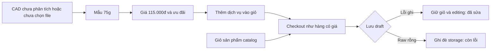
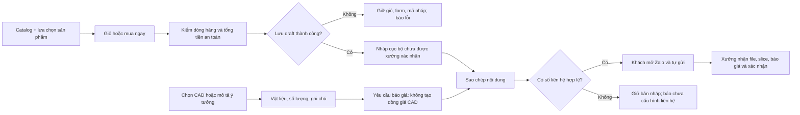

# BẢN CHỈ THỊ PHÊ DUYỆT KIẾN TRÚC & MÃ NGUỒN CHI TIẾT

**Số hiệu:** TT3D-ARCH-20261021-R2  
**Ngày ban hành:** 21/10/2026, múi giờ Asia/Saigon (UTC+07:00)  
**Đối tượng thi hành:** Antigravity Worker  
**Đối tượng thẩm định:** Nội dung CODEX BRIDGE được cung cấp qua stdin và mã nguồn hiện có trong workspace.

🎯 **[Auto-Router]** `Nhóm Task`: 3/4 — Kiến trúc Web, kiểm duyệt mã nguồn và nghiệm thu | `Skills`: computer-use:computer-use; các skill review được nêu trong ma trận không có trong catalog/thư mục skill đã kiểm tra | `MCP/Engines`: PowerShell, Node.js v24.20.0, Web; kiểm kê CUA không có trình duyệt kết nối.

## 1. Quyết định có hiệu lực ngay

**PHÊ DUYỆT kiến trúc HTML tĩnh, định hướng mỹ thuật và phương án hoàn thiện quy định dưới đây. PHÊ DUYỆT Antigravity triển khai ngay các thay đổi trong phạm vi này. CHƯA PHÊ DUYỆT trạng thái READY FOR HANDOVER hoặc phát hành production.**

R2 bổ sung và điều chỉnh kết luận đóng lỗi của [chỉ thị R1](../architecture-review-2026-10-21/ARCHITECTURE_DIRECTIVE.md). Giữ nguyên hồ sơ R1 để truy vết; không thay log cũ bằng kết quả mới. Không thay đổi Next.js, triển khai backend, đặt hàng thực, gửi tin nhắn hoặc xuất bản website trong đợt thẩm định này.

Phần tham vấn Gemini trong stdin là một báo cáo được cung cấp, không phải phiên tham vấn trực tiếp đã được xác minh trong lượt này. Kết luận của báo cáo đó dùng số test cũ và còn đề xuất tra cứu theo số điện thoại, trái với F06. Không dùng nội dung này làm căn cứ vượt cổng nghiệm thu của Codex. Không có lời gọi live đến Argon 9222/9223 hoặc Antigravity trong lượt này; tài liệu này là lệnh bàn giao để Worker thực thi.

## 2. Bằng chứng kiểm định độc lập

Đã chạy lại trên mã nguồn hiện tại, với mã thoát 0 cho từng lệnh:

| Kiểm tra | Kết quả | Loại bằng chứng | Raw log |
|---|---:|---|---|
| `tests/test_audit_r2_verification.js` | 5/5 PASS | Hành vi trong môi trường mô phỏng | [audit-r2.log](audit-r2.log) |
| `tests/test_audit_regressions.js` | 19/19 PASS | Hành vi trong Node VM/DOM stub | [regressions.log](regressions.log) |
| `tests/test_behavior.js` | 15/15 PASS | Hành vi trong môi trường mô phỏng | [behavior.log](behavior.log) |
| `test_tab_architecture.ps1` | 26/26 PASS | Kiểm tra chuỗi/regex mã nguồn | [tabs.log](tabs.log) |
| `test_e2e_simulation.ps1` | 6/6 PASS | Kiểm tra chuỗi/regex mã nguồn | [static-simulation.log](static-simulation.log) |
| `node --check` trên `js/*.js` | 13/13 PASS | Cú pháp | [syntax.json](syntax.json) |

Tổng **71 kiểm tra PASS = 39 kiểm tra hành vi/mô phỏng + 32 kiểm tra tĩnh**. 13 kiểm tra cú pháp được báo riêng. Không có bằng chứng cho 71 ca E2E trình duyệt.

Đã tạo và chạy [probe-handover.cjs](probe-handover.cjs), kết quả tại [probe-results.json](probe-results.json). Script dùng dữ liệu giả trong bộ nhớ Node VM, không đọc dữ liệu khách trên trình duyệt, không gọi mạng hoặc gửi tin nhắn. Đây là phép đo chẩn đoán có thể trả exit 0 khi còn phát hiện lỗi, **không phải acceptance suite PASS cho production**.

[source-snapshot.json](source-snapshot.json) lưu SHA-256 của các file nguồn/test liên quan tại cuối lượt rà soát và giới hạn kiểm định. Lượt này chỉ thêm hồ sơ thẩm định và probe; không sửa mã nguồn sản phẩm.

Các kết quả quyết định:

- Giả lập QuotaExceeded: thực sự đi tới **1 lần ghi draft**, ghi thất bại, state trở về `editing`, **0 lần clearCart**, có thông báo lỗi. Bỏ giả lập lỗi và thử lại: giữ mã nháp, lưu **1 record**, state `handoff_ready`, giỏ vẫn nguyên. F03 đã sửa đúng trường hợp lỗi ghi chính.
- Tracker nhận chuỗi markup thử nghiệm: chuỗi đi vào `textContent`, không vào `innerHTML`. Record có `items: [null]`, điện thoại dạng object, markup ở qty hoặc finalTotal bị loại. Đây là bằng chứng đóng sink cũ trong phạm vi controller, không chứng minh miễn dịch XSS toàn ứng dụng.
- Exact lookup nhận trim/case-insensitive; không khớp một phần mã hoặc số điện thoại. Projection không chứa địa chỉ, nhưng vẫn có `customerName` và `isFreeShipping` ngoài danh sách Worker báo cáo.
- Raw draft storage `{bad`, `{}`, `null` được giữ nguyên khi lưu; riêng raw **chuỗi rỗng `''` bị ghi đè**, state vẫn chuyển `handoff_ready`.
- Configurator chưa chọn file vẫn tính **115.000đ** từ 75g và gọi `TTStore.addToCart()` với `id` bắt đầu `print-quote-`. `cart.js` có gán alias `TTStore.addToCart = addToCart`; vì vậy đây là đường vào giỏ thật, không phải bằng chứng có hai giỏ riêng trong runtime đang tải đầy đủ.
- Resolver trả `null` nhưng checkout vẫn dựng liên kết tới số fallback `0986888333`. Khi resolver trả số hợp lệ, checkout dùng đúng số được cấu hình.
- Tương phản tính theo màu: trắng/cam **3,10:1**; than chì/cam **6,32:1**; than chì/hover **5,01:1**; than chì/active `#C44800` **3,98:1**; cam/nền sáng `#F8F9FA` **2,94:1**. Chỉ sửa màu mặc định của `.btn-primary` chưa đóng F08.

## 3. Đánh giá lại tám phát hiện R1

| Mã R1 | Trạng thái được công nhận | Phần còn lại |
|---|---|---|
| F01 — trung thực trạng thái | Đóng đối với tracker và kết quả checkout đã đọc | Giữ ranh giới bản nháp trên cả UI, admin, tài liệu; bổ sung nhãn mô phỏng 3D |
| F02 — DOM sink/schema | Đóng sink tracker cũ và các đầu vào lỗi đã tái hiện | Không công bố “miễn dịch 100%”; schema chưa xác thực tất cả enum/totals |
| F03 — lưu nháp/giỏ | Đóng lỗi QuotaExceeded và tự xóa giỏ | R2-03: bảo toàn storage tồn tại nhưng rỗng; bổ sung ca denied/read failure |
| F04 — resolver liên hệ | Đã có helper và ưu tiên cấu hình đúng | R2-04: bỏ fallback phân tán khi helper trả null |
| F05 — báo giá CAD | Đã bỏ suy gram từ dung lượng file, có extension/size gate | R2-01: vẫn biến mẫu 75g thành tiền và dòng checkout |
| F06 — lookup/PII | Đóng tìm tên/điện thoại/partial; không trả địa chỉ | Chốt whitelist projection và sửa báo cáo theo thực tế |
| F07 — đường phát hành | README xác định HTML tĩnh | R2-05: chưa có artifact/build tĩnh và kiểm thử artifact; npm build vẫn là Next.js |
| F08 — tương phản | Mặc định `.btn-primary` đạt 6,32:1 | R2-02: còn màu inline, active và chữ cam trên light theme |

Không kết luận “đã đóng toàn bộ P0/P1” từ báo cáo hiện tại. Các lỗi P0 cũ đã được khắc phục trong các ca tái hiện đã kiểm tra; chưa có kiểm chứng bảo mật toàn diện hoặc browser E2E để cấp chứng nhận rộng hơn.

## 4. Kiến trúc và phong cách được phê duyệt

Loại hình được chọn: **website studio có catalog sản phẩm, trình bày năng lực chế tác và tiếp nhận yêu cầu qua Zalo**. Runtime bản này là HTML/CSS/JS tĩnh; lưu nháp tại trình duyệt; xác nhận sản xuất do xưởng thực hiện qua kênh liên hệ. Không đặt tên tính năng là theo dõi máy in thời gian thực khi chưa có kết nối dữ liệu thực.

Giữ bốn workspace: Cửa hàng, Studio 3D, Yêu cầu báo giá CAD, Tiêu chuẩn & bản nháp. Giữ `TTCatalogStore` cho catalog/migration, `TTPurchaseConfig` cho cấu hình dòng sản phẩm, `TTCart` cho giỏ và `TTCheckout` cho phiên checkout. Controller render view model; không ghi record raw thẳng vào HTML.

Phê duyệt Tactile Industrial Minimalism: nền than chì, bề mặt mờ, một màu cam thương hiệu, Space Grotesk cho tiêu đề và Plus Jakarta Sans cho nội dung. Màu trạng thái phục vụ thông tin được dùng riêng; không biến mọi badge thành màu cam. Giảm kính mờ và chuyển động nếu làm giảm khả năng đọc. Nét riêng phải thể hiện qua hình ảnh có nguồn gốc rõ, lớp in, cách hoàn thiện, con người và quy trình thật của xưởng.

Trong lần đọc web này, [trang chủ thiendanglamgi.com](https://thiendanglamgi.com/) thể hiện danh mục, cổng hỗ trợ/tra cứu và nội dung ưu đãi lặp lại. Đây là bằng chứng về cấu trúc nội dung, không phải đánh giá đầy đủ giao diện động. [Trang custom](https://thiendanglamgi.com/custom) chỉ trả nội dung tải trang qua công cụ; **chưa xác minh được** kết luận “Coming Soon”, treo STL hoặc chất lượng chức năng hiện tại. Không đưa lời chê đối thủ hoặc tuyên bố “vượt trội hoàn toàn” vào copy thương hiệu. Teenage Engineering, Apple và B&O chỉ là tham chiếu thẩm mỹ trong đề xuất; lượt này không phải nghiên cứu đối sánh đầy đủ các hãng đó.

Không công bố cam là một tiêu chuẩn toàn cầu bắt buộc trong ngành in 3D. Dung sai ±0,15mm, chống thấm, chịu nhiệt và thời gian chế tác chỉ được trình bày như thông số có điều kiện và có dữ liệu kiểm tra phù hợp. Thống nhất các chỗ hiện đang nói 7 ngày, 30 ngày hoặc trọn đời theo chính sách thật đã được chủ xưởng xác nhận; không tự tạo cam kết mới.

## 5. Luồng hiện tại và luồng bắt buộc sau sửa





Việc mở URL, copy thành công hoặc lưu draft không làm website chuyển sang “xưởng đã nhận”, “đang in”, “đã thanh toán” hay “đã kích hoạt bảo hành”.

## 6. Lệnh sửa bắt buộc theo file

### R2-01 — P1: loại giá mẫu khỏi luồng yêu cầu CAD

**Vị trí:** `js/calculator.js:60–131, 205–259`; `index.html:851–909`; entry point `TTCheckout.openCheckout` trong `js/checkout.js`.

1. Biến configurator thành thu thập yêu cầu: `materialId`, `infill`, `qty`, `notes`, `fileName`, `fileSizeBytes`, `fileSelectedLocally`. Không có `unitPrice`, `totalPrice` hoặc khối lượng phân tích khi chưa slice. Giữ thông số 75g chỉ khi có khu vực ví dụ độc lập, ghi rõ mẫu minh họa và không gắn với file khách; phương án ưu tiên là bỏ khỏi UI này.
2. Đổi panel thành “Thông tin yêu cầu báo giá”; trạng thái giá là “Xưởng báo giá sau khi nhận file và cắt lớp”. Bỏ mức 115.000đ, ưu đãi tính theo mẫu và thời gian 24–48 giờ dạng cam kết cho mọi CAD.
3. CTA chính: “Mở Zalo gửi yêu cầu báo giá”. Cho khách xem và sao chép nội dung trước khi mở Zalo; không phụ thuộc riêng query `?text=` để đảm bảo tin đã được điền/gửi. Hướng dẫn: “File mới được chọn trên thiết bị. Hãy đính kèm file trong cuộc trò chuyện Zalo.” Không thể truyền `File` bằng tên file trong URL.
4. Bỏ nút “Thêm dịch vụ vào giỏ”. Nếu giữ global `addConfigQuoteToCart` để tương thích, hàm chỉ hướng dẫn dùng yêu cầu báo giá, **không gọi API thêm giỏ**. Không tạo đơn hàng có giá 0 để thay thế giá mẫu.
5. Chặn các dòng CAD cũ có id `print-quote-*` ở đầu vào checkout, cho cả cart và direct. Hiện thông báo yêu cầu xưởng báo giá và cho khách tự xử lý dòng cũ. Giữ dữ liệu giỏ; không âm thầm xóa hoặc đổi giá của khách.
6. Parse số lượng bằng `Number()` và kiểm số nguyên an toàn, phạm vi **1–100** cho yêu cầu CAD; không chấp nhận `2junk`, 1.5, Infinity. Giới hạn độ dài ghi chú; validate material/infill theo whitelist. Quy tắc tối đa 99 của giỏ catalog hiện có vẫn giữ nguyên.
7. Giữ extension whitelist `.stl/.step/.stp/.3mf/.obj`, giới hạn 25 MiB; reject file rỗng. Thông báo rõ đây là kiểm tên/kích thước file, chưa phân tích nội dung hình học. Tên file luôn dùng `textContent`. Không tự động tải file lên dịch vụ bên ngoài.

Contract tối thiểu được duyệt:

```js
// Request-only; đây không phải order line hoặc báo giá được xưởng chấp nhận.
{
  kind: 'cad_quote_request',
  materialId: 'pla_matte',
  infill: '15',
  qty: 1,
  notes: '',
  fileName: 'part.stl',
  fileSizeBytes: 1024,
  fileSelectedLocally: true
}
```

**Nghiệm thu:** chưa chọn file không xuất hiện tiền/gram thực tế; thay file không sinh giá; gọi hàm cũ không thêm giỏ; giỏ có dòng CAD cũ không đi tới chốt đơn bằng giá mẫu; các sản phẩm catalog tiếp tục đặt nháp được.

### R2-02 — P1: đóng F08 trên cả hai theme và các trạng thái

**Vị trí:** `css/style.css` phần tokens và button; `index.html:177, 186, 318, 705, 759, 817`; các template trong `js/` và nút admin.

1. Thay chữ trắng nhỏ trên cam bằng foreground than chì hoặc đổi nền đủ tối. Không chỉ sửa `.btn-primary`; rà badge số lượng, nút inline và hover classes.
2. Nền active hiện `#C44800` + chữ `#0B0C0E` chỉ đạt 3,98:1. Dùng màu active khác đã đo đạt ít nhất 4,5:1; có thể giữ nền hover cho active và dùng scale/viền để phản hồi nhấn.
3. Tạo token chữ accent riêng cho light theme. Cam `#FF5C00` trên nền sáng chỉ đạt 2,94:1, không dùng cho giá/chữ nhỏ trên nền đó. Màu nền CTA vẫn có thể giữ cam thương hiệu với foreground phù hợp.
4. Không dùng màu chữ inverse theo theme cho CTA nếu nó đổi thành trắng trên cam trong light mode. Dùng token chuyên biệt như `--button-primary-fg`.
5. Giữ focus hiển thị; badge trạng thái dùng token theme thay vì màu hổ phách sáng cố định trên nền light. Kiểm cả normal/hover/focus/active và thực tế computed styles.

Ngưỡng cho chữ thường là **4,5:1**, chữ lớn đủ điều kiện là **3:1**, theo [W3C WCAG 2.2 SC 1.4.3](https://www.w3.org/WAI/WCAG22/Understanding/contrast-minimum.html). Chữ đậm 10–12px không tự trở thành “large text”. Không tuyên bố toàn trang đạt WCAG AA từ một cặp màu.

### R2-03 — P1: phân biệt storage không tồn tại với JSON rỗng/hỏng

**Vị trí:** `js/checkout.js:145–184`, đặc biệt `if (raw)` tại dòng 155.

Thay điều kiện bằng `raw !== null`. Key không tồn tại mới khởi tạo `[]`; key chứa `''`, whitespace, JSON sai cú pháp hoặc JSON không phải mảng phải trả `INVALID_STORE`, giữ nguyên raw, không ghi lại. Giữ contract R1 và semantics upsert/retry hiện có:

```js
const raw = localStorage.getItem(DRAFT_ORDERS_KEY);
let list = [];
if (raw !== null) {
  try {
    list = JSON.parse(raw);
  } catch {
    return { ok: false, code: 'INVALID_STORE' };
  }
  if (!Array.isArray(list)) return { ok: false, code: 'INVALID_STORE' };
}
// Sau đó upsert, giới hạn 50, setItem trong try/catch hiện có.
```

`getDraftOrders()` có thể trả mảng rỗng khi không đọc được, nhưng không được tự “chữa” storage bằng ghi đè. Thông báo checkout phân biệt được INVALID_RECORD, INVALID_STORE và STORAGE_UNAVAILABLE; state/form/mã nháp/giỏ giữ nguyên để thử lại. Không cần export API nội bộ chỉ để test; ưu tiên test qua submit thật với form fixture hợp lệ.

**Nghiệm thu:** key absent lưu được; `''`, whitespace, `{bad`, `{}`, `null` giữ nguyên byte và 0 lần ghi; QuotaExceeded/SecurityError ở đọc hoặc ghi đều không xóa giỏ hay báo thành công; retry một mã chỉ có một record.

### R2-04 — P1: resolver là nguồn quyết định duy nhất của liên hệ

**Vị trí:** `js/checkout.js:13, 567–570`; `js/calculator.js:224`; `js/app.js` phần trợ giúp tracker; các link Zalo chung trong HTML.

1. Giữ ưu tiên helper `checkout.zaloHandoffPhone → shopInfo.zaloPhone → shopInfo.hotline` và chuẩn hóa `+84` hiện có.
2. Số mặc định được khai báo duy nhất trong cấu hình mặc định. Xóa `DEFAULT_ZALO` và fallback số literal tại consumer. Khi các ứng viên đều sai và helper trả null: không tự dựng liên kết tới một số khác.
3. Checkout vẫn lưu draft hợp lệ và cho sao chép nội dung. Với null, bỏ href/khả năng mở Zalo, hiển thị “Chưa cấu hình kênh Zalo hợp lệ”; không gắn trạng thái đã gửi. Configurator và tracker dùng cùng hành vi.
4. Link liên hệ chung ở header/footer/mobile phải được hydrate qua cùng resolver; với null hiển thị trạng thái không khả dụng. Link Zalo khách hàng trong admin là đích khác, phải lấy từ số khách đã validate, không thay bằng số xưởng.

Ví dụ nhánh consumer:

```js
const phone = window.TTStore?.getZaloPhone?.() ?? null;
if (phone) {
  link.href = `https://zalo.me/${phone}`;
  link.target = '_blank';
  link.rel = 'noopener noreferrer';
} else {
  link.removeAttribute('href');
  link.setAttribute('aria-disabled', 'true');
  // Đồng thời gỡ onclick mở Zalo và hiện thông báo cấu hình phù hợp.
}
```

**Nghiệm thu:** cả ba consumer dùng cùng số khi đổi cấu hình; +84 chuẩn hóa đúng; ứng viên đầu sai dùng ứng viên sau hợp lệ; tất cả sai không có URL điện thoại dự phòng. Không kiểm bằng gửi tin thật.

### R2-05 — P1/cổng bàn giao: tạo và nghiệm thu đúng artifact HTML tĩnh

**Vị trí:** `package.json`, cấu hình build tĩnh mới, `index.html`, `admin.html`, `README.md`.

1. Thêm lệnh riêng `build:static`, giữ rõ Next.js là thử nghiệm. `npm run build` hiện trỏ Next.js không được dùng làm bằng chứng build bản HTML tĩnh. Không chuyển framework trong bản sửa này.
2. Biên dịch Tailwind thành CSS tĩnh, bỏ `cdn.tailwindcss.com` và runtime `tailwind.config` khỏi artifact. Chuyển cấu hình theme tương ứng vào config build. Khóa dependency của pipeline tĩnh bằng lockfile; không bắt buộc cài toàn bộ runtime Next.js chỉ để build CSS.
3. Quét content cả `index.html`, `admin.html`, `js/**/*.js`; safelist đúng các class được ghép động. Không đổi major Tailwind trong cùng đợt sửa. [Tài liệu Tailwind](https://tailwindcss.com/docs/installation/play-cdn) xác định Play CDN dành cho phát triển, không dành cho production.
4. Build vào thư mục artifact riêng bằng allowlist: HTML phát hành, CSS đã build, runtime JS, assets, products và dữ liệu registry thật sự được tải. Không copy `.git`, reports, CODEX_BRIDGE, backup HTML, script nội bộ hoặc `src/` vào public output. Giữ admin cục bộ đúng phạm vi đã duyệt; PIN JavaScript không bảo vệ dữ liệu server hoặc bí mật.
5. Three.js HTML hiện dùng r128 và OrbitControls 0.128.0, trong khi manifest Next.js dùng `^0.169.0`. Giữ cặp global runtime tương thích trong bản sửa này; không đổi OrbitControls/API theo manifest Next.js một cách riêng lẻ. Ghi rõ dependency thực của artifact, có fallback khi WebGL/CDN không tải được.
6. README hướng dẫn chạy bằng static HTTP server với document root là artifact. Không lấy mở `file://` làm đường nghiệm thu fetch/catalog. Admin đang so PIN `2026` trong mã, README lại ghi `1234`: sửa tài liệu cho đúng và gọi đây là khóa giao diện cục bộ, không phải xác thực an toàn.
7. Tạo manifest SHA-256 của artifact và ghi commit/source snapshot tương ứng. Build lặp lại từ cùng đầu vào phải cho nội dung tương đương, không phụ thuộc dữ liệu localStorage của người build.

**Nghiệm thu:** phục vụ artifact qua HTTP; tải mới không cần Tailwind runtime; catalog/registry/assets đúng; không có 404 runtime; không có file nội bộ trong output; E2E chạy trên artifact đó.

### R2-06 — P1/cổng minh bạch: khớp tính năng, tài liệu và bằng chứng

**Vị trí:** `index.html` phần Studio/CAD/standards, `README.md`, báo cáo trả Worker.

1. Viewport hiện dùng hình học tham số trong `loadModelGeometry()`, không thấy nhãn “mô phỏng” trong HTML đã kiểm tra. Hiện nhãn sát viewport: “Mô phỏng hình dáng và vật liệu; không dùng để kiểm kích thước sản phẩm”. Không mô tả là mesh sản phẩm thật hoặc soi lớp in thật khi chưa có dữ liệu đó.
2. README bỏ “miễn dịch 100%”; thay bằng phạm vi đã đo: tracker dùng `textContent`, schema chặn các ca thử liệt kê, chưa audit toàn ứng dụng. DOM API an toàn là hướng xử lý phù hợp [OWASP DOM XSS Prevention](https://cheatsheetseries.owasp.org/cheatsheets/DOM_based_XSS_Prevention_Cheat_Sheet.html), không phải chứng nhận tuyệt đối.
3. Không ghi tất cả ảnh là “ảnh sản phẩm thật” chỉ vì file tồn tại. Ghi rõ ảnh tham khảo/render nếu chưa có chứng cứ nguồn gốc. Không tự kết luận quyền thương mại của model từ tên repo hoặc download link; hồ sơ nguồn gốc là công việc nội dung riêng.
4. Đồng bộ copy CAD với request-only; bỏ hứa “báo giá chính xác 100% trong 15 phút” nếu không có quy trình hỗ trợ cam kết đó. Thống nhất copy chính sách theo thông tin đã được chủ xưởng chấp thuận; giữ mục chưa có dữ liệu ở trạng thái cần xác nhận.
5. Tách số lượng test theo loại; sửa mô tả “functional/E2E” của PowerShell để không đánh đồng tìm chuỗi với thao tác browser. Không giữ assertion buộc tồn tại nút thêm CAD vào giỏ sau khi nút đó đã được loại theo spec.

## 7. Hoàn thiện schema và projection trong cùng vùng chỉnh sửa

Các điểm này là P2 về độ chặt của contract, chưa có bằng chứng khai thác từ xa; không diễn giải thành lỗ hổng XSS mới:

- `isValidOrderRecord()` hiện chấp nhận channel dạng object và subtotal dạng markup khi finalTotal hợp lệ. Validate `schemaVersion`, `source`, `status`, `channel` theo version/enum; tương thích record cũ thiếu trường bằng migration/projection rõ ràng, không âm thầm xóa record.
- Mọi trường tiền **nếu có** phải là safe integer không âm; discountPercent trong 0–100; qty và các phép nhân/cộng phải an toàn, không chỉ từng toán hạng. Với order mới, totals phải được tính từ items bằng một hàm dùng chung; giữ các quy tắc vận chuyển/chiết khấu đang được test.
- Chốt whitelist lookup: `clientRequestId`, `createdAt`, `statusText`, `channel`, `maskedPhone`, `items[{title,qty,price}]`, `estimatedTotalVnd`, có thể thêm `isFreeShipping` phục vụ UI. Bỏ `customerName` khỏi view công khai nếu không cần; sửa phần render tương ứng. Không trả địa chỉ, ghi chú, NFC WiFi/password hoặc phone đầy đủ.
- Masking giảm dữ liệu hiển thị, không cung cấp xác thực/phân quyền. Raw draft vẫn ở cùng origin của khách; không quảng bá như kho đơn bảo mật tập trung. Không thêm backend hoặc OTP vào bản này chỉ để hợp thức hóa copy cũ.

## 8. Automation: phê duyệt ngoại tuyến, triển khai theo nhu cầu

| Engine | Vai trò được duyệt | Điều kiện đầu ra |
|---|---|---|
| Remotion | Video hero/teaser sản xuất ngoại tuyến | Poster tĩnh, muted/playsinline nếu tự chạy, tôn trọng reduced motion; không tải đồng thời năm video |
| Slidev | Lookbook/catalog B2B độc lập | Version catalog rõ, thông số khớp dữ liệu sản phẩm đã duyệt |
| Python PPTX/COM | Tạo tài liệu báo giá sau khi xưởng có dữ liệu slice | Có mã yêu cầu/version; không biến dữ liệu 75g mẫu thành báo giá đã xác nhận |
| CapCutAPI | Dựng nội dung giới thiệu xưởng ngoại tuyến | Kiểm media/timeline/export thật; không gọi file local hoặc MCP Windows từ trình duyệt khách |

Các mô tả năng lực trong stdin chưa chứng minh pipeline đã chạy end-to-end. R2 không render video, xuất PPTX hoặc gọi CapCut. Không bắt Worker chạy các pipeline này trước khi đóng lỗi checkout. Khi có nhiệm vụ nội dung cụ thể, dùng đúng skill, chạy ngầm và render GPU tuần tự theo AGENTS; chỉ dừng tiến trình do tác vụ sở hữu, không đóng phiên PowerPoint người dùng đang làm việc.

## 9. Thứ tự thi hành và cổng kiểm định

1. Lưu snapshot/hash các file liên quan và diff hiện có. Workspace đang có nhiều thay đổi từ trước; không reset, ghi đè hoặc gom commit thay đổi ngoài phạm vi. Cập nhật FIX-NOTES/SPEC theo bằng chứng mới trước khi sửa luồng CAD.
2. Thực hiện R2-01, R2-03 và R2-04; giữ các ca catalog migration/tombstone/rollback/Mua ngay đang PASS.
3. Sửa R2-02 và R2-06; chỉnh schema/projection tại vùng đã sửa, không refactor toàn dự án.
4. Sửa tests theo contract mới; thêm ca hành vi thật ở Node VM với fixture đủ form, counters khẳng định đường lỗi được chạy. Không làm test PASS bằng trả sớm trước setItem hoặc kiểm tồn tại tên hàm.
5. Tạo artifact R2-05; chạy regression và test cú pháp đúng các file artifact phát hành.
6. Kiểm trình duyệt thật trên artifact, lưu ảnh desktop/mobile và console/network; mỗi bước báo kết quả thực, không dùng output của script regex làm ảnh/bằng chứng browser.
7. Nộp ma trận đóng từng R2, log mã thoát, diff và artifact manifest cho Codex. Worker có thể báo `IMPLEMENTATION COMPLETE — AWAITING REVIEW`; chỉ báo READY FOR HANDOVER sau khi đủ cổng và được Codex nghiệm thu.

Không yêu cầu người dùng xác nhận lại các sửa chữa đã được phê duyệt ở đây. Nếu thiếu thông tin chính sách kinh doanh hoặc không có hạ tầng browser, Worker vẫn hoàn thiện phần độc lập và ghi chính xác phần chưa xác minh; không tự tạo chính sách hoặc báo hoàn tất giả.

## 10. Ma trận acceptance tối thiểu

| Ca | Thao tác/đầu vào | Kết quả cần quan sát |
|---|---|---|
| A01 | Catalog Mua ngay A, giỏ đang có B | Nháp chỉ có A, giỏ B còn nguyên |
| A02 | Đặt từ giỏ, double click submit | Một draft/mã, không tự xóa giỏ |
| A03 | QuotaExceeded thật trong stub có bộ đếm | Đã thử ghi, state editing, giỏ/form/mã giữ nguyên, có thông báo |
| A04 | Bỏ lỗi sau A03 và retry | Một record với cùng mã, không nhân đôi |
| A05 | Raw `''`, whitespace, malformed, object, null | Không ghi đè; không báo lưu thành công |
| A06 | SecurityError ở getItem hoặc setItem | Lỗi lưu rõ ràng, không mất giỏ |
| A07 | Items null/markup qty/markup total và record hợp lệ cạnh record hỏng | Bỏ record hỏng, render record hợp lệ an toàn, không crash |
| A08 | Exact mã có trim/case; partial mã, tên và phone | Exact trả projection; các kiểu tra kia không khớp |
| A09 | Config Zalo ưu tiên/+84/fallback hợp lệ/null | Đúng resolver; null không sinh số đích khác; vẫn copy được |
| A10 | CAD chưa file, file hợp lệ, sai đuôi, 0 byte, >25 MiB | Luồng yêu cầu đúng; không có tiền/gram từ mẫu; lỗi file rõ ràng |
| A11 | Gọi hàm thêm CAD cũ hoặc checkout dòng `print-quote-*` lưu sẵn | Không tạo order định giá; không tự xóa giỏ |
| A12 | CAD qty 1, 100, 101, 1.5, `2junk` | Chỉ 1–100 nguyên hợp lệ được nhận |
| A13 | Theme dark/light, normal/hover/active/focus | Chữ thường ≥4,5:1; kiểm computed style và vùng chữ thực |
| A14 | Desktop 1440×900 và mobile 390×844/360×800 | Bốn tab/hash/back/forward; CTA/modal/dock không che nhau |
| A15 | Bàn phím Tab/Escape, mở/đóng modal | Focus thấy được, không lạc vào nền; không khóa scroll sau đóng |
| A16 | Mở Studio, đổi tab, đổi kích thước, WebGL unavailable | Resize đúng; có fallback; nhãn mô phỏng hiển thị; catalog vẫn dùng được |
| A17 | Clipboard bị từ chối, Zalo không mở được | Có preview/manual copy; không hiển thị đã gửi/đã nhận |
| A18 | Load mới artifact qua HTTP | Không cần Play CDN; không 404 runtime/uncaught error; không chứa hồ sơ nội bộ |

Lượt thẩm định này **chưa chạy A14–A18 trên browser**: kiểm kê `cua.getState()` trả `apps: []`, `browsers: []`. Không có ảnh desktop/mobile, computed styles thực hoặc console/network để xác nhận. Những ca VM đã chạy chỉ được công nhận đúng phạm vi ghi trong mục 2.

Sau sửa, thêm acceptance tests trả nonzero nếu sai contract. Giữ [probe-handover.cjs](probe-handover.cjs) làm công cụ đo, cập nhật schema đầu ra nếu cần; không đổi tên một phép đo thành “PASS” khi chưa có assertion.

## 11. Bộ hồ sơ Antigravity phải trả

- `HANDOVER_R2.md`: mã R2 → file/dòng → thay đổi → ca acceptance → log/ảnh → trạng thái, kèm các P2 còn lại được ghi rõ.
- Diff phạm vi được sửa; snapshot/source hash; artifact manifest SHA-256 và lệnh build/serve/test tái chạy được.
- Raw logs, mã thoát từng lệnh, môi trường trình duyệt, viewport, ảnh và console/network đã kiểm tra. Dữ liệu thử phải là giả; không ghi dữ liệu khách thật vào log.
- Báo cáo các giới hạn còn lại: local draft, chọn file chưa upload, 3D mô phỏng, Zalo cần khách tự gửi, admin local PIN không phải bảo mật server.

**Lệnh kết thúc:** Antigravity thi hành theo mục 9. Được triển khai ngay trong phạm vi đã duyệt. Giữ trạng thái **APPROVED FOR REMEDIATION — NOT READY FOR PRODUCTION HANDOVER** đến khi R2-01…R2-06 và cổng browser/artifact có bằng chứng đạt.
