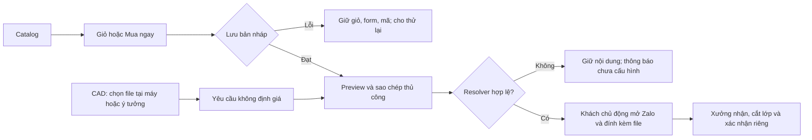

# BẢN CHỈ THỊ PHÊ DUYỆT KIẾN TRÚC & MÃ NGUỒN CHI TIẾT

**Số hiệu:** TT3D-ARCH-20261021-R3 — THẨM ĐỊNH CUỐI BÁO CÁO R2  
**Ngày ban hành:** 21/10/2026, Asia/Saigon  
**Đơn vị ban hành:** Codex Master Controller  
**Đơn vị thi hành:** Antigravity Worker  
**Đầu vào:** CODEX_BRIDGE qua stdin, CODEX_BRIDGE.md trên đĩa, HANDOVER_R2.md, chỉ thị R2 và mã nguồn/artifact hiện có.

🎯 **[Auto-Router]** `Nhóm Task`: 3/4 — Kiến trúc Web, review mã nguồn và nghiệm thu | `Skills`: computer-use:computer-use; các skill review trong ma trận không tìm thấy ở thư mục skill đã kiểm tra | `MCP/Engines`: PowerShell, Node.js v24.20.0, Web; CUA không có browser kết nối.

## 1. Quyết định cuối của lượt thẩm định

**PHÊ DUYỆT kiến trúc HTML tĩnh và các phần sửa R2 đã có bằng chứng. PHÊ DUYỆT Antigravity thi hành ngay các phần còn thiếu trong văn bản này. CHƯA PHÊ DUYỆT READY FOR HANDOVER hoặc phát hành production đối với artifact đang trình.**

Báo cáo “hoàn thành 100% toàn bộ R2-01…R2-06” chưa phù hợp với mã nguồn: còn ba thiếu sót đã tái hiện ở cả nguồn và artifact, cùng cổng kiểm thử trình duyệt chưa thực hiện. Đây là quyết định thẩm định dựa trên bằng chứng, không phải yêu cầu người dùng xác nhận lại. Worker được sửa ngay trong phạm vi đã duyệt.

Trạng thái chính thức: **APPROVED FOR COMPLETION — FINAL HANDOVER NOT APPROVED**. Không dùng kết luận Gemini cũ trong stdin để thay quyết định này: đoạn đó sử dụng số test cũ, đề xuất tra cứu điện thoại đã bị loại, và tuyên bố bảo mật tuyệt đối đã bị rút. Lượt này không có tham vấn trực tiếp Argon hoặc gửi lệnh qua một phiên Antigravity; tài liệu này là lệnh bàn giao cho Worker.

Không thay đổi runtime sang Next.js, không thêm backend, không gửi tin Zalo thật, không triển khai website hoặc sửa chính sách kinh doanh trong đợt hoàn thiện này.

## 2. Kết quả kiểm định độc lập

| Phép kiểm | Kết quả chạy lại | Phạm vi thực |
|---|---:|---|
| test_audit_r2_verification.js | 5/5 PASS, exit 0 | Hành vi catalog trong VM |
| test_audit_regressions.js | 19/19 PASS, exit 0 | Hành vi với VM/DOM stub |
| test_behavior.js | 15/15 PASS, exit 0 | Hành vi kinh doanh mô phỏng |
| test_tab_architecture.ps1 | 26/26 PASS, exit 0 | Chuỗi/regex trên mã nguồn |
| test_e2e_simulation.ps1 | 6/6 PASS, exit 0 | Chuỗi/regex; không chạy trình duyệt |
| probe-handover.cjs | exit 0, số đo chính đã cải thiện | Probe chẩn đoán; chỉ assertion một phần |
| node --check nguồn | 13/13 PASS | Cú pháp |
| node --check dist | 13/13 PASS | Cú pháp |
| Manifest artifact | 102/102 payload khớp SHA-256 và size | Manifest không tự băm chính nó; tổng 103 file gồm manifest |
| Kiểm tra bổ sung R3 | **19 PASS / 25 kiểm tra; 6 FAIL; exit 1** | 12 ca chạy trên nguồn, 12 ca trên artifact, 1 ca manifest |
| Desktop/mobile, computed styles, console/network | **CHƯA KIỂM** | CUA trả apps=[], browsers=[] |

Số “72/72” trong báo cáo Worker thực chất gộp **71 kiểm tra cũ và một lần chạy probe**. Không công nhận nó là 72 acceptance tests đầy đủ hoặc 72 ca browser E2E. Có 39 kiểm tra hành vi mô phỏng và 32 kiểm tra tĩnh trong 71 kiểm tra cũ. Syntax được báo riêng.

Sáu FAIL bổ sung là **ba thiếu sót lặp lại trên hai bản**, không phải sáu lỗi độc lập:

1. `index.html`/`admin.html` trong artifact vẫn có `cdn.tailwindcss.com` và runtime `tailwind.config`.
2. Nhánh tracker không tìm thấy bản nháp vẫn dựng URL tới số dự phòng khi resolver trả null.
3. CAD không có preview/manual copy của nội dung yêu cầu khi clipboard bị từ chối; vẫn hiện toast “Đã mở Zalo và sao chép nội dung yêu cầu báo giá!”.

Bằng chứng mới: [verification.json](verification.json), [runner-evidence.json](runner-evidence.json), [verify-final.cjs](verify-final.cjs), các raw log cùng thư mục. `runner-evidence.json` chứa kết quả gọi lệnh trực tiếp thực tế. Lần đầu gọi child_process.spawnSync trong Node bị sandbox chặn EPERM; đã chạy lại trực tiếp qua PowerShell và công cụ thực thi, tất cả lệnh nền cũ hoàn tất exit 0. Không tính lần bị chặn là lỗi sản phẩm. Chính sách chạy script PowerShell được chỉ định cho tiến trình kiểm thử, không thay đổi thiết lập hệ thống lâu dài.

`verify-final.cjs` chạy lại các phép đo bổ sung hiện thời, đồng thời **đọc** bằng chứng các suite nền trong runner-evidence.json; nó không tự chạy lại các suite nền. Khi tái nghiệm thu phải làm mới bằng chứng nền trước. Các fixture chỉ có dữ liệu giả trong bộ nhớ; không đọc storage khách hàng hoặc gửi mạng từ các ca VM.

Lượt này chỉ thêm hồ sơ thẩm định. Không sửa nguồn sản phẩm, không rebuild/ghi đè dist và không thay lịch sử R1/R2. Manifest hiện có được kiểm trực tiếp; chưa xác nhận build tái lập từ môi trường sạch.

## 3. Ma trận quyết định cho sáu hạng mục R2

| Hạng mục | Được công nhận | Phần chưa đóng | Kết luận |
|---|---|---|---|
| R2-01 CAD | Không còn tạo dòng giá mẫu; hàm tương thích không thêm giỏ; chặn print-quote ở cart và direct | Preview, manual copy và trạng thái clipboard/open window trung thực | Đạt phần request-only; chưa đóng toàn bộ trải nghiệm |
| R2-02 tương phản | Token mặc định/hover/active và màu cam trên light canvas đã sửa trong CSS | Computed styles, nền thực, focus, inline/dynamic, dark/light trên artifact | Chấp nhận sửa token; chưa cấp kết luận WCAG toàn giao diện |
| R2-03 storage | Absent, rỗng, whitespace, malformed, object, null; denied read/write; quota/retry giữ mã và giỏ đều đạt fixture | Giữ regression hiện có | Đóng trong phạm vi các ca đã đo |
| R2-04 resolver | Checkout và nhánh tracker có kết quả đã xử lý null; CAD không tự fallback số | Tracker no-match còn fallback; link Zalo cố định trong HTML chưa đồng bộ | Chưa đóng |
| R2-05 artifact | Có allowlist, 102 payload, manifest đúng; cú pháp 13 file artifact đạt | Chưa compile Tailwind, chưa lock pipeline, chưa HTTP/browser acceptance | Chưa đóng |
| R2-06 minh bạch | Có nhãn mô phỏng; projection 8 field không có tên/địa chỉ; README ghi PIN local | Sửa báo cáo PASS/E2E và trạng thái bàn giao theo bằng chứng | Đạt phần copy/projection; hồ sơ nghiệm thu chưa đủ |

Phê duyệt giữ kiến trúc catalog + studio + yêu cầu CAD + bản nháp cục bộ, bốn workspace, `TTCatalogStore`, `TTPurchaseConfig`, `TTCart`, `TTCheckout`. Giữ phong cách Tactile Industrial Minimalism, nền than chì, một điểm nhấn cam và typography hiện tại. Không mở lại các phần catalog/migration đã PASS nếu không có lỗi tái hiện mới.

Luồng được duyệt:



## 4. R3-01 — Hoàn tất R2-05: CSS phát hành và build thật

**Ưu tiên:** P1, cổng bàn giao.  
**Vị trí bằng chứng:** `dist/index.html:28–30`, `dist/admin.html:15–17`, `scripts/build-static-artifact.js`, `package.json`, `tailwind.config.ts`.

Builder hiện chỉ copy file và băm; không có bước biên dịch CSS. Config Tailwind hiện tại chỉ quét `src/`, không quét HTML tĩnh/JS runtime. Chưa có lockfile pipeline. Manifest hợp lệ chứng minh tính toàn vẹn gói hiện có, không chứng minh gói đạt yêu cầu phát hành.

**Chỉ thị mã nguồn được duyệt:**

1. Tạo config riêng `tailwind.static.config.cjs` hoặc tương đương. Content phải gồm `index.html`, `admin.html`, `js/**/*.js`; đưa theme từ các block inline vào config build, bảo toàn font/token thực đang dùng. Giải quyết khác biệt theme trang chủ/admin bằng cấu hình hợp nhất hoặc hai output CSS rõ ràng. Không dùng nhánh config Next.js hiện tại một cách nguyên trạng.
2. Tạo CSS đầu vào với `@tailwind base; @tailwind components; @tailwind utilities;`. Biên dịch bằng Tailwind **3.x đã khóa phiên bản cụ thể**. Có thể đặt toolchain nhỏ ở `tooling/static/` với package.json và package-lock.json để không cài Next.js chỉ phục vụ build CSS. Không đổi major Tailwind trong đợt này.
3. Bổ sung các class ghép động có kiểm soát vào safelist hoặc chuyển sang chuỗi class đầy đủ/CSS variables; không safelist toàn bộ tùy tiện. Bao gồm class trong template strings, modal, tracker và sản phẩm sinh bằng JS.
4. Thứ tự CSS: utilities đã compile trước; `style.css`/`admin.css` sau theo cascade đã thiết kế. Artifact HTML chỉ tham chiếu CSS build cục bộ, loại toàn bộ Play CDN script và block `tailwind.config` tương ứng. Có thể giữ CDN cho source dev nếu có chủ đích, nhưng acceptance bắt buộc áp dụng cho artifact. Điều chỉnh ca R3 kiểm source nếu chọn giữ nguồn dev; không nới điều kiện artifact.
5. `npm run build:static` phải gọi bước compile, kiểm mã thoát, rồi đóng gói và sinh manifest cuối cùng. Khi compile thất bại phải exit nonzero, không báo BUILD HOÀN TẤT. Thiếu entrypoint hay CSS bắt buộc cũng phải fail. Kiểm đường dẫn output nằm trong workspace trước mọi xóa đệ quy; không xóa thư mục ngoài dist/build tạm của tác vụ.
6. Allowlist tiếp tục loại hồ sơ, tests, backup và `.git`; chỉ đưa dữ liệu runtime thực cần. `js/category-registry.js` đã chứa registry sinh sẵn, không bắt buộc copy `data/` chỉ vì test nguồn đọc thư mục đó. Kiểm các URL fetch thực tế khi serve.
7. Giữ cặp Three.js r128/OrbitControls 0.128.0 đang dùng trong HTML; không nâng một nửa theo dependency Next.js. Ghi runtime dependencies thực của artifact. Cần fallback khi CDN/WebGL không có; kiểm trong browser.
8. Build hai lần cùng đầu vào và so sánh digest payload. Cho phép buildTimestamp trong manifest khác nhau; mọi khác biệt payload khác phải được giải thích. Chụp snapshot/hash nguồn/test/build config và manifest của bản cuối. Không tính hash của một bản rồi test một bản khác.

Play CDN được Tailwind xác định cho phát triển, không dành cho production. [Tài liệu chính thức Tailwind v3](https://v3.tailwindcss.com/docs/installation/play-cdn).

**Acceptance bắt buộc:** artifact không có `cdn.tailwindcss.com` hoặc `tailwind.config =`; CSS local tồn tại, không rỗng; chặn domain Play CDN vẫn giữ bố cục; desktop/mobile và UI sinh động có style; lỗi compile trả nonzero; manifest cuối bao phủ đúng payload.

## 5. R3-02 — Hoàn tất R2-04: null resolver trên mọi nhánh liên hệ

**Ưu tiên:** P1.  
**Vị trí:** `js/app.js:545–554` (no-match), `js/app.js:705` (nhánh có kết quả để giữ regression), link Zalo cố định trong `index.html`, consumer calculator/checkout.

Ca VM: `lookupOrder()` trả `[]`, resolver trả `null`, submit mã giả. Kết quả thực: vẫn sinh `https://zalo.me/0986888333`. Đây là nhánh chưa được probe cũ kiểm.

**Contract được duyệt:**

```js
const phone = window.TTStore?.getZaloPhone?.() ?? null;
link.removeAttribute('href');
link.removeAttribute('target');
if (phone) {
  link.href = `https://zalo.me/${phone}?text=${encodeURIComponent(message)}`;
  link.target = '_blank';
  link.rel = 'noopener noreferrer';
  link.removeAttribute('aria-disabled');
  link.onclick = null; // hoặc hành vi copy có chủ đích
} else {
  link.setAttribute('aria-disabled', 'true');
  link.onclick = event => {
    event.preventDefault();
    // Hiện preview/manual copy và thông báo chưa cấu hình; không mở URL.
  };
}
```

1. Bỏ fallback số tại nhánh no-match. Giữ số mặc định hợp lệ ở **config trung tâm** nếu đó là cấu hình xưởng; không chuyển nó thành fallback ở consumer.
2. Dùng cùng resolver cho các liên kết Zalo cố định được phát hành trong HTML để cấu hình đổi thì link đổi; khi null không còn đích cũ. Áp dụng theo thuộc tính mục tiêu như `data-zalo-contact`, không ghi đè mọi anchor/tel tùy tiện.
3. Xóa trạng thái URL/click cũ khi cập nhật từ số hợp lệ sang null; khi trở lại hợp lệ thì bỏ trạng thái disabled. `aria-disabled` đơn thuần không chặn navigation: phải bỏ href hoặc chặn sự kiện tương ứng.
4. Giữ khả năng xem/copy nội dung và mã nháp kể cả khi không có số. Không gọi `window.open()` khi resolver null. Hotline có thể có resolver riêng theo semantics tel; không dùng một số Zalo mặc định làm hotline khác cấu hình.

**Acceptance:** có kết quả/không kết quả, resolver tồn tại/vắng mặt, null, +84, đổi số, ứng viên đầu sai ứng viên sau đúng; khẳng định URL và số lần open thực tế. Không gửi tin thử đến số thật.

## 6. R3-03 — Hoàn tất R2-01/A17: CAD preview, copy và thông báo trung thực

**Ưu tiên:** P1.  
**Vị trí:** `js/calculator.js:179–224`, panel CAD trong `index.html`.

Hiện tại `navigator.clipboard.writeText(message).catch(() => {})` bỏ qua lỗi, sau đó vẫn báo đã copy. Không có preview hoặc textarea chứa nội dung yêu cầu cho khách copy bằng tay. Tên file và lời nhắc đính kèm đã có, cần giữ.

**Thiết kế được duyệt:**

1. Tách `buildCadQuoteMessage(request)` thành hàm thuần; request vẫn không có giá, tiền hay gram mẫu. Các lựa chọn vật liệu/infill phải theo whitelist; notes tối đa 500 ký tự. Không biến request thành order 0 đồng.
2. Thêm vùng preview có nhãn và textarea readonly, nút “Sao chép yêu cầu”, nút “Mở Zalo”. Tên file/nội dung dùng `textContent` hoặc `.value`; không nội suy vào innerHTML.
3. Hành động lập yêu cầu phải luôn hiển thị preview trước khi khách mở liên hệ. Nút copy await Clipboard API trong try/catch, kiểm `typeof navigator !== 'undefined'`; fallback focus/select textarea và cho Ctrl+C. Chỉ báo “Đã sao chép” sau khi Promise thành công. Khi bị từ chối, ghi “Chưa sao chép tự động; hãy sao chép nội dung bên dưới”.
4. Nút mở liên hệ là anchor có URL từ resolver và kích hoạt trực tiếp bởi khách. Tách thao tác mở khỏi await copy để không làm mất user activation/pop-up. Nếu dùng window.open, xử lý kết quả bị chặn trong những trường hợp API cho phép phát hiện; không suy diễn đã mở từ việc gọi hàm. Không báo Zalo đã nhận/gửi hoặc clipboard thành công khi chưa có bằng chứng.
5. Null resolver: disable/bỏ URL nút mở, preview và nút copy vẫn dùng được. Query `?text=` chỉ hỗ trợ chuyển tiếp; không thay thế preview hoặc chứng minh file đã upload. Khách vẫn phải đính kèm file thật trong cuộc trò chuyện.
6. Giữ kiểm extension, >25 MiB, 0 byte và dòng CAD cũ; bổ sung tests hành vi cho các gate này. Số lượng phải là số nguyên 1–100; nếu UI sửa input sai thành 1 thì phải phản ánh rõ trước khi lập preview, không báo đã chấp nhận giá trị sai.

**Acceptance:** clipboard thành công, reject, API không có; resolver null; mở Zalo bị chặn/không hoạt động; file tốt/sai đuôi/rỗng/quá giới hạn; notes/tên file chứa markup; qty 1/100/101/1.5/2junk. Mọi trường hợp còn xem và copy thủ công được; không có giá giả hoặc mutation giỏ.

## 7. R3-04 — Nghiệm thu artifact trên browser và chỉnh hồ sơ

**Ưu tiên:** cổng bàn giao bắt buộc theo R2, không phải yêu cầu tính năng mới.

Màu token được tính lại: than chì/cam **6,3205:1**, than chì/hover & active `#E05200` **5,0099:1**, `#C44800`/canvas `#F8F9FA` **4,6611:1**. Con số 5,0:1 cho cặp cuối trong HANDOVER_R2 không chính xác; cặp này vẫn vượt 4,5:1 với màu đặc. Probe cũ còn field `charcoalOnActive` tính màu cũ `#C44800`, không phải active hiện tại. Đổi nhãn phép đo hoặc đọc token đúng, không coi field đó là lỗi active mới.

Các giá trị này chưa tính opacity, nền composite, CSS specificity hoặc computed style. WCAG AA yêu cầu 4,5:1 cho chữ thường, 3:1 cho chữ lớn trong phạm vi tiêu chí; không dùng một token đạt để tuyên bố toàn trang đạt. [W3C SC 1.4.3](https://www.w3.org/WAI/WCAG22/Understanding/contrast-minimum.html).

Worker phải serve **dist** qua HTTP rồi thực hiện và lưu bằng chứng:

| Ca | Thao tác | Bằng chứng đạt |
|---|---|---|
| B01 | 1440×900, 390×844, 360×800; bốn tab; hash/back/forward | Ảnh từng viewport, không tràn ngang hoặc dock che CTA |
| B02 | Giỏ có B, Mua ngay A; checkout từ giỏ; double submit | Nháp đúng nguồn, B giữ nguyên, một record/mã |
| B03 | Quota/denied, bỏ lỗi rồi retry | Form/giỏ/mã giữ nguyên, retry một record |
| B04 | Tracker exact/partial/phone; cả found/no-match và null resolver | Không lộ tên/địa chỉ; không có số đích dự phòng |
| B05 | CAD preview/copy/reject/no clipboard/null Zalo | Nội dung luôn copy thủ công được, trạng thái trung thực |
| B06 | Dark/light, normal/hover/active/focus; CTA, badge, chữ cam | Computed foreground/background và tỷ lệ thực của vùng chữ |
| B07 | Tab/Shift+Tab/Escape ở modal/giỏ; mở/đóng | Focus thấy rõ, focus modal không đi vào nền, trả focus, phục hồi scroll |
| B08 | Studio, đổi tab/resize, CDN/WebGL không có | Fallback rõ ràng, không crash uncaught, catalog/checkout dùng được |
| B09 | Tải mới/cold storage trên artifact, chặn Play CDN | CSS local, catalog/registry/assets đúng; không 404 runtime hoặc uncaught error |
| B10 | Kiểm manifest/hash sau cùng và danh sách output | Đúng artifact đã test; không lộ hồ sơ nội bộ |

Console/network phải được quan sát trong suốt các luồng, ghi request lỗi cụ thể và cách xử lý; không chỉ ghi “clean” từ regex. Dùng dữ liệu giả. Không mở/sửa storage của người dùng thật để thử. Khi tạo môi trường thử local, chỉ phục vụ trên loopback và chỉ dừng tiến trình do tác vụ tạo.

Lượt này CUA không có kết nối browser, không có ảnh hoặc browser trace. Worker có công cụ phù hợp có thể tự hoàn tất B01–B10; nếu chưa có thì ghi **UNVERIFIED** và tiếp tục các phần độc lập, không giả ảnh/test, không xin người dùng xác nhận thay cho bằng chứng.

Sửa `HANDOVER_R2.md` bằng addendum hoặc tạo `HANDOVER_R3.md` để giữ lịch sử: tách các loại test, sửa “E2E” của hai PowerShell test thành kiểm tra tĩnh, ghi rõ trạng thái chưa bàn giao và liên kết quyết định này. Chuyển probe thành acceptance suite có assertion cho từng metric hoặc giữ nó là diagnostic và dùng bộ acceptance riêng. Không chỉ tăng tổng test bằng một lượt chạy script.

Projection đã đo đạt tám field: clientRequestId, createdAt, statusText, channel, maskedPhone, items, estimatedTotalVnd, isFreeShipping. Tiếp tục render bằng DOM API an toàn, không mở lại lookup qua tên/điện thoại. Đây là biện pháp trong phạm vi controller, không phải xác thực hay chứng nhận toàn ứng dụng an toàn. [OWASP DOM XSS Prevention](https://cheatsheetseries.owasp.org/cheatsheets/DOM_based_XSS_Prevention_Cheat_Sheet.html).

## 8. Trình tự thi hành và hồ sơ phải nộp

1. Lưu diff và snapshot nguồn trước sửa. Workspace có nhiều thay đổi từ trước; không reset hoặc gom sửa ngoài phạm vi. Giữ raw logs R1/R2 và hồ sơ R3 này.
2. Sửa R3-02 và R3-03, chạy lại các ca lỗi gốc. Duy trì regression catalog/tombstone/rollback/checkout hiện có.
3. Hoàn tất R3-01, build sạch với dependency lock, test cú pháp đúng output và kiểm manifest.
4. Chạy suite nền, acceptance có assertion và B01–B10 trên artifact cuối. Nếu thay nguồn sau browser test, rebuild và kiểm lại phần chịu ảnh hưởng; manifest cuối phải chỉ tới bản thực đã test.
5. Nộp HANDOVER_R3, diff theo file, raw logs/mã thoát, snapshot SHA-256, lockfile, lệnh build/serve, ảnh/console/network/browser version/viewport, ma trận R2 và R3 với từng ca đạt/chưa kiểm.
6. Chỉ sau khi tất cả cổng đạt mới trình Codex ban hành quyết định READY FOR HANDOVER gắn với manifest cụ thể. Không tự gộp `AWAITING REVIEW / READY FOR HANDOVER` thành một trạng thái.

**Phê duyệt cuối của lượt hiện tại:** kiến trúc và phần sửa đã chứng minh được chấp nhận; **yêu cầu phê duyệt bàn giao toàn bộ bị từ chối ở artifact hiện tại** do ba thiếu sót tái hiện và thiếu nghiệm thu browser. Antigravity được thực thi ngay bốn mục R3 nêu trên, không cần hỏi lại quyền sửa đã được người dùng và chỉ thị này cấp.
