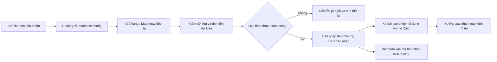

# BẢN CHỈ THỊ PHÊ DUYỆT KIẾN TRÚC & MÃ NGUỒN CHI TIẾT

Mã: TT3D-ARCH-20261021-R1 · Ngày: 21/10/2026 · Người thực thi: Antigravity Worker.

**QUYẾT ĐỊNH: PHÊ DUYỆT ĐỊNH HƯỚNG THIẾT KẾ VÀ PHƯƠNG ÁN SỬA DƯỚI ĐÂY. CHƯA PHÊ DUYỆT BÀN GIAO PRODUCTION.**

Antigravity được triển khai ngay các công việc P0/P1 trong chỉ thị này. Chỉ chuyển trạng thái sang READY FOR HANDOVER sau khi hoàn tất các điều kiện nghiệm thu. Đồng thuận được trích dẫn của Argon là đầu vào tư vấn; không thay thế bằng chứng từ mã nguồn, kiểm thử và trình duyệt.

## 1. Phạm vi và bằng chứng thẩm định

- Đã đọc nội dung CODEX BRIDGE do người dùng cung cấp qua stdin và đối chiếu workspace thực tế.
- Mốc Git khi thẩm định: `0da616e`; working tree có nhiều thay đổi chưa commit. Kết quả áp dụng cho snapshot đang đọc, không đồng nghĩa toàn bộ commit đó đã được kiểm định.
- Đã rà soát các đường dữ liệu liên quan tại `index.html`, `css/style.css`, `js/checkout.js`, `js/app.js`, `js/calculator.js`, `js/viewer3d.js`, cấu hình và admin; xem cấu trúc Next.js trong `src/`, scripts, tests và các manifest automation. Đây là rà soát theo rủi ro, không phải chứng nhận mọi dòng mã trong repo.
- Node thực chạy: `v24.20.0`. Không sửa mã nguồn sản phẩm trong lượt thẩm định này.
- Không có `chrome-devtools`, `pro-account-1/2` hay `capcut-api` callable trong phiên. Inventory Computer Use trả `apps: []`, `browsers: []`; chưa có nghiệm thu hình ảnh, console, network hoặc E2E trình duyệt thực.
- Các skill review/web được nêu trong ma trận AGENTS không tìm thấy trong catalog hiện hành; việc rà soát thực hiện trực tiếp bằng đọc mã, Node VM và kiểm thử có sẵn. Không giả lập việc đã nạp các skill thiếu.

| Kiểm tra đã chạy lại | Kết quả | Giá trị bằng chứng |
|---|---:|---|
| `tests/test_audit_r2_verification.js` | 5/5 | Hành vi trong môi trường mock/VM |
| `tests/test_audit_regressions.js` | 18/18 | Hành vi trong môi trường mock/VM |
| `tests/test_behavior.js` | 15/15 | Hành vi trong môi trường mock/VM |
| `test_tab_architecture.ps1` | 26/26 | Kiểm tra chuỗi/regex mã nguồn |
| `test_e2e_simulation.ps1` | 6/6 | Kiểm tra chuỗi/regex mã nguồn; không phải browser E2E |
| `node --check` trên `js/*.js` | 13/13 | Cú pháp; không chứng minh chức năng hoặc bảo mật |

Tổng số kiểm tra hiện có đúng là 70 PASS: 38 kiểm tra hành vi/mô phỏng và 32 kiểm tra tĩnh. Hai script PowerShell ban đầu bị execution policy chặn; đã chạy được bằng `-ExecutionPolicy Bypass` trong tiến trình con, không đổi policy hệ thống.

Phép thử bổ sung có thể tái chạy bằng:

```powershell
node reports/architecture-review-2026-10-21/probe-current-behavior.cjs
```

Script chỉ dùng dữ liệu giả trong bộ nhớ, không ghi storage trình duyệt, không gửi tin nhắn. Nó trích controller thật vào Node VM với DOM stub để quan sát sink; chưa chứng minh payload được thực thi trong trình duyệt.

## 2. Các phát hiện bắt buộc xử lý

| Mã | Mức | Bằng chứng hiện tại | Chỉ thị |
|---|---|---|---|
| F01 | P0 | `js/app.js:563` gắn cố định “Đang Gia Công & Bảo Hành 1-1”; `js/checkout.js:458` lưu `handoff_ready` cục bộ | Hiển thị đúng bản nháp trên thiết bị; không suy ra tiến độ máy in, xác nhận đơn hoặc bảo hành |
| F02 | P0 | `js/app.js:584` nội suy `totals.finalTotal`; `:602` nội suy `item.qty` vào `innerHTML` | Kiểm schema và render dữ liệu bằng `textContent`; đóng đường chèn markup |
| F03 | P0 | `saveOrderDraft()` nuốt lỗi; `submitCheckout()` vẫn đổi state và `clearCart()` | Lưu phải có kết quả rõ ràng; giữ giỏ khi thất bại và khi mới chuẩn bị chuyển tiếp |
| F04 | P1 | `TT_CONFIG` dùng `shopInfo/checkout`; checkout đọc `TT_CONFIG.hotline/zalo`, rơi về số dự phòng `0968988647` | Một resolver liên hệ dùng chung, đọc đúng cấu trúc cấu hình |
| F05 | P1 | `js/calculator.js:67–68` suy gram từ MB; `:311` chỉ giữ `File` trong bộ nhớ | Loại kết quả giả khỏi luồng chốt tiền; phân biệt chọn file, truyền file, phân tích file |
| F06 | P1 | `lookupOrder()` dùng `includes` theo mã, >=4 chữ số điện thoại, tên; trả record nguyên gốc | Tra chính xác mã bản nháp; projection cho UI; không dùng masking làm cơ chế xác thực |
| F07 | P1 | Runtime HTML tĩnh và Next.js cùng tồn tại, nhưng tests chỉ chạy đường HTML tĩnh | Chốt một đường phát hành; build đúng đường đó |
| F08 | P1 | Các nút mới có chữ trắng trên nền `#FF5C00`: tương phản tính toán 3.10:1 | Sửa toàn bộ cặp màu chữ nhỏ để đạt ngưỡng AA |

F02 có tiền điều kiện: dữ liệu không tin cậy phải đi vào storage hoặc luồng tương đương cùng origin. Chưa xác minh được đường khai thác từ xa không cần đăng nhập; không được quảng bá là đã có hoặc không có đường đó. Tuy nhiên dữ liệu storage có thể thay đổi, và đây là unsafe DOM sink đã quan sát được.

Phép thử hiện tại quan sát được: payload ở tổng tiền và số lượng đến `innerHTML`; `items: [null]` làm render ném TypeError; `phone: {length: 10}` làm `rawPhone.slice` ném TypeError. Dữ liệu JSON parse được chưa đồng nghĩa đúng schema.

F03 đã tái hiện: giả lập `setItem()` ném lỗi → 0 bản ghi được lưu → context vẫn `handoff_ready` → giỏ bị xóa 1 lần. Đây là mất dữ liệu trong luồng đặt hàng, không được chấp nhận khi bàn giao.

F04 đã tái hiện với số giả: cấu hình `checkout.zaloHandoffPhone = 0900000000`, nhưng checkout sinh URL đến `0968988647`. Không xác định chủ sở hữu số dự phòng; phải loại sai lệch cấu hình trước khi khách sử dụng.

## 3. Kiến trúc được duyệt cho bản sửa hiện tại

Giữ ứng dụng HTML/CSS/JavaScript hiện có làm đích sửa và nghiệm thu của đợt này. Không chuyển sang Next.js, không duy trì hai bản giao diện song song trong một đợt sửa. `src/` được giữ nguyên như nhánh triển khai khác; README phải ghi rõ chưa thuộc bản bàn giao này.



`TTCatalogStore` chịu trách nhiệm dữ liệu sản phẩm và migration; `TTPurchaseConfig` chuẩn hóa lựa chọn và giá dòng hàng; `TTCart` giữ giỏ; `TTCheckout` điều khiển checkout và draft; controller chỉ render view model. Các kiểm thử migration, tombstone, rollback và giỏ/Mua ngay hiện có tiếp tục là điều kiện giữ ổn định.

Lưu cục bộ, clipboard thành công, hoặc mở Zalo đều không chứng minh xưởng đã nhận yêu cầu. Bản sửa phải phản ánh đúng ranh giới đó trên cả UI, admin, README và báo cáo.

## 4. Lệnh sửa mã nguồn theo file

### A. `js/checkout.js`: schema, lưu trữ và giao dịch

1. Giữ `getDraftOrders()` tương thích cho admin đang gọi API này. Thêm kiểm schema từng record, bỏ qua record sai khi đọc; không tự ghi đè dữ liệu gốc hỏng bằng mảng rỗng. Lỗi parse/storage phải được báo bằng mã lỗi riêng cho controller cần hiển thị trạng thái lỗi; không gộp tất cả thành “không có đơn”.
2. Trường hợp record không hợp lệ: không render, không ném lỗi toàn màn hình, không log PII. Kiểm `customer` là object, các trường tên/điện thoại/địa chỉ là string có giới hạn, `items` là mảng object hữu hạn, `qty` nguyên dương, `price` và tổng là số nguyên an toàn không âm, ngày hợp lệ, mã là string có độ dài giới hạn. Kiểm tràn khi nhân/cộng tiền. Giữ giá 0 hợp lệ theo contract hiện tại; không biến giá lỗi thành 0.
3. Giữ giới hạn 50 draft. Mặc định đề xuất thời hạn bản nháp 30 ngày, ghi rõ trong UI và chỉ xóa bản ghi hết hạn có schema hợp lệ. Cung cấp thao tác khách tự xóa lịch sử, xóa thông tin ghi nhớ riêng; không tạo bản sao PII trong log/backup mặc định.
4. `saveOrderDraft()` trả union kết quả dưới đây. Với raw JSON hỏng/sai kiểu, trả lỗi và giữ nguyên raw. Với lỗi ghi, trả lỗi; không chuyển state thành thành công. Deduplicate theo cùng `clientRequestId` khi retry, không tạo mã mới mỗi lần bấm lại.

```js
// Contract phải áp dụng cho mọi nhánh của saveOrderDraft:
// { ok: true, clientRequestId: string }
// { ok: false, code: 'INVALID_RECORD' | 'INVALID_STORE' | 'STORAGE_UNAVAILABLE' }

const saved = saveOrderDraft(orderRecord);
if (!saved.ok) {
  currentCheckoutContext.state = 'editing';
  showCheckoutError(saved.code); // Dùng DOM textContent; cho phép thử lại.
  return;
}
currentCheckoutContext.state = 'handoff_ready';
// Hiển thị “Đã lưu bản nháp trên thiết bị. Chưa gửi tới xưởng.”
// Không clearCart ở bước chuẩn bị hoặc khi chỉ mở liên kết Zalo.
```

Đây là contract và điểm tích hợp được duyệt, không phải đoạn thay thế trọn hàm. Worker phải hiện thực validator, lỗi UI và adapter admin tương ứng. Chỉ cho xóa giỏ theo thao tác rõ ràng của khách; bản có backend sau này có thể xóa sau khi server xác nhận giao dịch idempotent.

5. Sửa copy COD: “Đã chuẩn bị yêu cầu COD trên thiết bị. Hãy gửi nội dung cho xưởng để xác nhận.” Bỏ câu khẳng định xưởng đã lưu và sẽ gọi khi không có API nhận đơn. COD là phương thức mong muốn, chưa phải một đơn đã tiếp nhận.
6. Phân biệt opt-in ghi nhớ tên/điện thoại/địa chỉ với lịch sử draft. Thông báo việc draft có chứa dữ liệu trên thiết bị dùng chung; tránh lưu thêm PII không cần thiết. Không đưa dữ liệu khách vào thông báo lỗi, analytics hoặc URL tra cứu.

### B. `js/app.js` và `index.html`: tra cứu đúng chức năng

1. Đổi tiêu đề thành **“Bản nháp đặt hàng trên thiết bị này”**. Mô tả rõ không đồng bộ thiết bị và chưa cung cấp tiến độ máy in trực tiếp. Không hiển thị “Đang gia công”, “Đã kích hoạt”, “Đã thanh toán” từ localStorage.
2. `lookupOrder(query)` tra **toàn bộ mã chính xác**, trim và không phân biệt hoa thường. Không tìm theo tên, số điện thoại hoặc đoạn mã ở bản tĩnh. Không dùng `TT3D-XXXX` như một token bí mật hay cơ chế xác thực.
3. `getDraftOrders()` có thể phục vụ admin cục bộ sau validation. `lookupOrder()` trả view model riêng: `clientRequestId`, ngày hợp lệ, trạng thái cục bộ cố định, `maskedPhone`, `items` đã chuẩn hóa, `estimatedTotalVnd`. Không trả địa chỉ/ghi chú/điện thoại đầy đủ qua API tra cứu UI.
4. Mọi giá trị động phải đi vào `textContent`. Chỉ dùng `innerHTML` cho template tĩnh không nội suy dữ liệu. Không chèn `item.qty`, tổng tiền, ngày, nhãn trạng thái hay tên file trực tiếp vào HTML string dù dự kiến chúng là số/string an toàn.

```js
const quantity = document.createElement('span');
quantity.textContent = `x${item.qty}`; // item đã qua validator.
const amount = document.createElement('span');
amount.textContent = `${view.estimatedTotalVnd.toLocaleString('vi-VN')} đ`;
const status = document.createElement('span');
status.textContent = 'Bản nháp trên thiết bị · Chưa xác nhận';
```

5. Empty, invalid query, corrupt storage, storage unavailable và no match là các trạng thái riêng. Vùng kết quả dùng `aria-live="polite"`, form có label, submit bằng Enter hoạt động. Tránh lộ thông tin khách khác trên máy dùng chung.
6. Đổi “Kích hoạt bảo hành 1 đổi 1” thành **“Yêu cầu hỗ trợ bảo hành qua Zalo”**. Mở chat không được cập nhật eligibility/activation. Chỉ hiển thị chính sách và điều kiện đã có bằng chứng vận hành; bỏ các cam kết mới tự thêm như bảo hiểm vận chuyển 100% nếu chưa được xác nhận.
7. Clipboard thất bại/không hỗ trợ phải hiện nội dung để copy thủ công. Chỉ báo “Đã sao chép” khi promise thành công; không phụ thuộc query `?text=` sẽ được mọi client Zalo điền tự động.

### C. `js/config.js`, checkout, calculator, tracker: một nguồn liên hệ

Thêm helper vào `TTStore` hiện hữu; không gán mới cả object làm mất các API khác. Checkout, calculator và tracker cùng gọi helper tại thời điểm người dùng thao tác để nhận cấu hình mới nhất.

```js
window.TTStore.getZaloPhone = function () {
  const cfg = window.TTStore.getConfig();
  const candidates = [
    cfg?.checkout?.zaloHandoffPhone,
    cfg?.shopInfo?.zaloPhone,
    cfg?.shopInfo?.hotline
  ];
  for (const raw of candidates) {
    if (typeof raw !== 'string') continue;
    let phone = raw.replace(/[\s.()-]/g, '');
    if (/^\+84\d{9}$/.test(phone)) phone = '0' + phone.slice(3);
    if (/^0[35789]\d{8}$/.test(phone)) return phone;
  }
  return null;
};
```

Đây là quy tắc di động Việt Nam phục vụ cấu hình hiện tại, không phải validator mọi số điện thoại quốc tế. Cấu hình không hợp lệ: hiện lỗi và vô hiệu hóa nút chat, không âm thầm chuyển đến số khác. Khách có thể copy mã/nội dung bằng thao tác riêng.

Tạo URL bằng `new URL('https://zalo.me/' + phone)` và `searchParams.set` nếu cần tin nhắn ngắn. Chỉ đưa mã tham chiếu/nội dung hỗ trợ tối thiểu vào URL; nội dung đặt hàng đầy đủ được cung cấp để khách copy và tự gửi. Link `_blank` có `rel="noopener noreferrer"`. Không hardcode số tại controller.

### D. `js/calculator.js`, `index.html`: chấm dứt báo giá từ dung lượng file

- Bỏ công thức gram từ MB và giá mặc định 75g khỏi luồng được trình bày như kết quả phân tích CAD. Hai STL cùng hình học có thể khác dung lượng; kích thước file không phải khối lượng nhựa hoặc thời gian in.
- Bản hiện tại chỉ được gọi **“Gửi yêu cầu báo giá”**. Ghi rõ chọn file tại máy chưa có nghĩa file đã được truyền tới xưởng. Không báo “đã tải lên” khi chỉ giữ một đối tượng `File` trong bộ nhớ.
- Khi chưa phân tích thật, không thêm dòng dịch vụ có giá suy đoán vào checkout như hàng có giá chốt. Chuyển CTA đó sang yêu cầu tư vấn/báo giá; giữ giỏ sản phẩm bán sẵn hoạt động.
- Kiểm phần mở rộng và dung lượng trước khi giữ file; giới hạn đề xuất 25 MiB, một file/lượt. Đây chỉ là kiểm tra UI, không phải xác thực an toàn nội dung. File không hỗ trợ/lỗi/quá lớn phải có thông báo cụ thể.
- Đợt sau nếu làm quote thật: STL cần đơn vị và mesh hợp lệ; STEP cần CAD kernel/conversion; 3MF cần giới hạn giải nén và kiểm cấu trúc. Preview bằng Three.js không thay thế slicer. Support, orientation, layer height, infill, nozzle, mật độ vật liệu, overhead và profile máy phải tham gia ước tính, có phiên bản và đối chiếu file mẫu đã slice.
- Chưa có pipeline đó thì không công bố thời gian in/khối lượng chính xác hoặc giá tức thì từ CAD. Chỉ xuất báo giá PDF/PPTX sau khi giá và thông số có nguồn xác nhận.

### E. `js/viewer3d.js`: preview và tài nguyên

- Mô hình hiện được dựng tham số qua `loadModelGeometry()`. Gắn nhãn “Mô phỏng hình dáng/chất liệu” khi không có asset hình học tương ứng sản phẩm; không tuyên bố soi lớp in thực hoặc bảo đảm màu sản phẩm từ render.
- Load engine/model khi mở Studio lần đầu; có loading, error, timeout, WebGL unsupported/context lost và ảnh thay thế. Tránh chặn cửa hàng/checkout khi 3D thất bại.
- Hiện vòng RAF vẫn lên lịch trước khi kiểm workspace hidden. Cho phép dừng animation khi workspace/document không hiển thị, khởi động lại một vòng duy nhất khi quay lại; render theo tương tác khi không cần animation.
- Giải phóng geometry/material/texture toàn cây `Group` khi đổi model, xử lý material array và tài nguyên dùng chung; không chỉ dispose thuộc tính ở object cha. Dùng resize theo kích thước container và giới hạn DPR phù hợp máy yếu.
- Đồng bộ Three.js/OrbitControls cùng một phiên bản được khóa. Không trộn runtime CDN `0.128.0` với API theo dependency `^0.169.0` trong `package.json` mà chưa kiểm tra tương thích.

### F. `css/style.css`, HTML và build: chốt mỹ thuật có thể sử dụng

- Phê duyệt “Tactile Industrial Minimalism”: nền than chì, ảnh sản phẩm và khoảng trắng làm trọng tâm; cam là điểm nhấn thương hiệu; màu trạng thái phục vụ thông tin.
- Giữ Space Grotesk cho tiêu đề/số liệu, Plus Jakarta Sans cho nội dung, mono cho dữ liệu ngắn. Kiểm tiếng Việt có dấu. Gộp font request đang trùng giữa HTML và CSS; chỉ tải weight cần dùng.
- Dùng một bộ CSS token thống nhất; chọn `#14171C` làm surface theo đặc tả hoặc cập nhật đặc tả đồng bộ với `#14161C` hiện có. Không sửa màu rời rạc từng component.
- Cam `#FF5C00` không phải một “tiêu chuẩn ngành in 3D thế giới” đã được xác minh; mô tả là lựa chọn nhận diện của T&T.
- Chữ trắng/cam đặc có tỷ lệ 3.10:1, không đạt 4.5:1 cho chữ thường nhỏ. Dùng chữ than chì trên cam (tính toán 6.32:1) hoặc nút cam đậm đã kiểm tra; kiểm cả hover/focus/disabled và light theme. Không coi mọi nút hiện tại đều lỗi: class `btn-primary-accessible` đã dùng màu nền đậm khác.
- Tận dụng reduced-motion CSS đã có, mở rộng cho auto-rotate/hero media. Focus rõ, modal trap focus/Escape/restore focus, dock không che CTA, zoom 200% và màn 360px không tràn ngang. Đây là tiêu chí phải đo, chưa được nghiệm thu trong lượt này.
- Giữ tối đa một hero nổi bật trong khung nhìn đầu. Năm danh mục có sản phẩm hero nhưng không tải/auto-play đồng thời năm video. Ưu tiên ảnh thật, chi tiết lớp in và quy trình xưởng thay cho kính mờ và badge dày đặc.
- Thay Tailwind Play CDN bằng CSS build trước production. Tạo config build riêng cho HTML tĩnh, quét `index.html`, `admin.html`, `js/**/*.js`; config Next hiện tại chỉ quét `src/` nên không dùng nguyên trạng. Chuyển token inline sang config và bảo toàn class động cần safelist. Không nâng major hoặc migration framework trong cùng bản sửa.
- Thêm lệnh `build:static`, khóa dependency bằng lockfile, lưu artefact và chỉ dẫn phát hành đúng thư mục public. Không upload nguyên workspace, `.git`, bridge, reports, tests, scripts hoặc file cấu hình riêng lên web public. Không coi `server.ps1` phục vụ toàn workspace là production server.
- `admin.html` có PIN hardcode trong JavaScript chỉ là khóa giao diện cục bộ. Không gọi đó là xác thực server hoặc hệ thống quản trị đơn của khách từ thiết bị khác.

## 5. Công cụ automation: duyệt ở vai trò sản xuất nội dung ngoại tuyến

Đã xác nhận tồn tại các thư mục/manifest sau; chưa chạy smoke render, chưa kiểm chứng end-to-end từng tool:

| Công cụ | Bằng chứng đọc được | Vai trò được duyệt |
|---|---|---|
| Remotion `video-effects-engine` | Manifest có Remotion `4.0.536`, React `19.2.3` | Sản xuất hero clip/poster ngoại tuyến; không ghép dependency vào runtime web hiện tại |
| `slidev-presentation` | Manifest có Slidev `^52.3.0` | Catalog/Lookbook tĩnh sau khi chốt nội dung |
| `Python_PPTX_Video_Engine` | Script demo và venv python tồn tại | Tạo tài liệu nội bộ sau khi có dữ liệu báo giá đúng; chưa có bằng chứng dịch vụ báo giá tự động |
| CapCutAPI | `mcp_server.py` tồn tại; import phụ thuộc được bọc try/except | Ghép nội dung marketing sau smoke test; tạo draft không đồng nghĩa đã xuất MP4 |

Không đưa đường dẫn Windows, COM, MCP server hoặc secret vào browser bundle; không chạy chúng theo request trực tiếp từ khách. Clip đề xuất 6–10 giây, muted/playsinline, poster, lazy-load, chỉ play trong viewport; có lựa chọn giảm chuyển động. Đây là giai đoạn nội dung sau khi P0/P1 đã đóng.

Render GPU tuần tự theo AGENTS. COM chỉ dùng tiến trình do tác vụ tạo và đóng bằng `try/finally`. Không kill toàn bộ PowerPoint của người dùng để dọn một job.

## 6. Đối sánh và các khẳng định phải sửa trong báo cáo

Trang chủ thiendanglamgi.com truy cập qua công cụ web có danh mục, tra cứu đơn/bảo hành và nhiều dòng khuyến mại lặp. Đây là cơ sở tham khảo cấu trúc dịch vụ và cường độ thông tin. Đánh giá “bình dân/cao cấp” là nhận định thiết kế, không phải kết luận kỹ thuật khách quan. [Nguồn trang chủ](https://thiendanglamgi.com/).

Trang `/custom` trong kết quả đọc lần này chỉ có nội dung tải trang, bản thu thập cũ khoảng ba tháng. Chưa đủ bằng chứng khẳng định tính năng đang hỏng/Coming Soon ở thời điểm hiện tại. Bỏ kết luận T&T “vượt trội hoàn toàn” dựa vào điều này. [Nguồn Custom](https://thiendanglamgi.com/custom).

Không tự công bố sai số ±0.15mm, chịu nhiệt, kín nước tuyệt đối, bảo hiểm 100%, đổi mới vô điều kiện, tiến độ Bambu 24/7 hay bảo hành tự kích hoạt nếu chưa có dữ liệu đo, điều kiện áp dụng và xác nhận vận hành. Tham chiếu Teenage Engineering/Apple/B&O là cảm hứng, không dùng làm bằng chứng sản phẩm đạt chuẩn tương đương.

## 7. Cổng tra cứu thật: kiến trúc giai đoạn kế tiếp

Chưa yêu cầu Worker dựng backend mới để hợp thức hóa bản sửa này. Nếu triển khai tính năng tra cứu từ thiết bị khác, áp dụng thiết kế riêng sau:

- Backend/DB là nguồn trạng thái đơn hàng duy nhất; cập nhật bởi nhân sự hoặc tích hợp máy in có xác thực. Giá, chiết khấu, tồn kho và tổng tiền được xác minh phía server.
- Tạo yêu cầu qua API idempotent, dùng ID nội bộ/UUID đầy đủ và mã hiển thị riêng. Đoạn UUID 8 ký tự hiện tại không dùng làm bearer secret.
- Tra cứu bằng session có quyền trên đơn, hoặc OTP kèm ràng buộc đơn, hoặc token CSPRNG entropy tối thiểu 128 bit có giới hạn phạm vi/thời hạn/thu hồi. Đừng phát token khi chỉ biết mã ngắn hoặc số điện thoại.
- API trả projection tối thiểu sau kiểm quyền; không endpoint tìm tất cả đơn bằng tên hoặc vài số điện thoại. Rate limit, chống dò tồn tại, HTTPS, `Cache-Control: no-store`, log đã bỏ PII và kiểm thử truy cập chéo đơn.
- State đơn: submitted/confirmed/queued/printing/quality_check/shipping/delivered/cancelled. Bảo hành có state riêng requested/under_review/approved/rejected. Chỉ backend có thẩm quyền xác nhận chuyển state; gửi Zalo không là bằng chứng chuyển state.
- Kết nối Bambu phải có nguồn dữ liệu thật, phân quyền, thời điểm cập nhật và trạng thái stale/offline; không dựng progress giả từ thời gian trình duyệt.

## 8. Thứ tự thi hành và cổng nghiệm thu

Thực thi từng bước, ghi diff và bằng chứng; không báo xong chỉ dựa số lượng PASS:

1. Ghi snapshot/diff và phạm vi runtime. Không reset hay ghi đè các thay đổi của người dùng; không sửa lại tombstone/catalog đang PASS nếu không có bằng chứng cần thiết.
2. Đóng F02 và validator dùng chung cho tracker/admin; sửa F03 lưu thất bại, copy COD, giữ giỏ; sửa F01/F06 trạng thái và tra đúng mã. Các việc này là P0.
3. Đóng F04 resolver liên hệ và các consumer. Đóng F05 copy/file/CTA báo giá, F07 static build, F08 tương phản. Đồng bộ README và báo cáo tính năng với hiện trạng thật.
4. Chạy bộ regression hiện hữu. Sửa kỳ vọng của Ca O vì trước đây test cố tình chấp nhận tìm theo tên/số điện thoại một phần; thay bằng contract mới, không chỉ xóa test để giữ số PASS.
5. Bổ sung các ca chống tái phát trong bảng dưới; chạy E2E trình duyệt thật qua HTTP. Chụp desktop 1440px, mobile 360px và 390px, cả hai theme; lưu log console/network và kết quả thao tác.
6. Worker gửi gói bằng chứng để Master nghiệm thu. Mọi cổng đã đạt mới ghi READY FOR HANDOVER; chưa đạt ghi đúng mã blocker. Không tự khẳng định đã có phê duyệt production từ chỉ thị này.

| Ca nghiệm thu mới | Kết quả bắt buộc |
|---|---|
| Mã chính xác/khác hoa thường, partial ID, tên, 4 số cuối | Chỉ mã đầy đủ hợp lệ trả draft; các truy vấn khác không trả dữ liệu |
| JSON hỏng, object thay array, record/null item, phone object | Không crash; báo lỗi thích hợp; không ghi đè raw hỏng |
| Markup ở tên/mã/tổng/qty/title/fileName | Render text hoặc từ chối record; không tạo phần tử/event handler từ payload |
| QuotaExceeded/storage denied | Không báo xưởng đã nhận; giữ giỏ và mã retry; hiển thị đường khôi phục |
| Bấm đôi/retry | Một draft cho cùng clientRequestId; không nhân đôi giỏ hoặc nội dung |
| Chỉ chuẩn bị COD/mở Zalo | Không đổi thành đơn đã xác nhận/gia công/bảo hành; không tự xóa giỏ |
| Đổi số cấu hình bằng fixture giả | Mọi CTA dùng đúng số mới; số sai thì vô hiệu hóa chat, không fallback âm thầm |
| Clipboard denied/unavailable | Không báo copy thành công; có văn bản copy thủ công |
| Thiết bị/browser mới | Giải thích không có draft tại thiết bị; không kết luận đơn khách không tồn tại ở xưởng |
| Chọn file/không file/quá lớn/sai định dạng | Không suy gram từ MB; không chốt giá CAD giả; chỉ rõ file chưa gửi |
| Mua ngay A khi giỏ có B | Checkout chỉ A; giỏ B còn nguyên |
| Back/forward/hash reload, mở Studio từ card | Điều hướng thực đúng, canvas có kích thước khác 0, lỗi 3D không làm hỏng checkout |
| Theme/keyboard/mobile/zoom/reduced motion | CTA đọc được và thao tác được; không che focus/CTA; tương phản đạt ngưỡng |
| Static build phục vụ từ thư mục phát hành | Có đủ CSS động/assets; không lộ file nội bộ; không cần Tailwind Play CDN |

Ngưỡng chất lượng đề xuất cho bản phát hành: LCP ≤2.5s, CLS ≤0.1 và INP ≤200ms theo dữ liệu người dùng thực khi đã đủ mẫu. Trước phát hành dùng lab measurements được ghi cấu hình máy/mạng; không diễn giải điểm lab thành bằng chứng đã đạt INP ngoài thực tế. Đây là mục tiêu dự án, chưa có số đo trong lượt này.

## 9. Gói Worker phải bàn giao

- Danh sách file đổi và lý do; runtime/build/output thực tế; commit hoặc hash nội dung gói phát hành.
- Lệnh test và raw log/exit code; phân biệt unit/mock, kiểm tra tĩnh và browser E2E. Báo số mới đúng thực tế, không ép về 70.
- Ảnh, console/network log đã loại PII; mô tả ca lỗi cũ trước/sau, gồm storage fail, DOM sink và số Zalo.
- README khách hàng mô tả đúng bản nháp cục bộ và báo giá thủ công; ghi rõ những tích hợp chưa triển khai.
- Xác nhận nội dung chính sách có căn cứ và danh sách giới hạn còn lại. Không ghi “100% miễn dịch XSS”, “bảo mật 100%” hay “production-ready” chỉ từ node --check hoặc mock PASS.

## 10. Căn cứ kỹ thuật ngoài repo

- Dữ liệu localStorage không được coi là tin cậy và có thể bị JavaScript cùng origin đọc; masking ở giao diện không phải cơ chế kiểm soát quyền. [OWASP HTML5 Security](https://cheatsheetseries.owasp.org/cheatsheets/HTML5_Security_Cheat_Sheet.html).
- Dùng DOM API an toàn như textContent cho dữ liệu động và tránh unsafe HTML sinks. [OWASP DOM XSS Prevention](https://cheatsheetseries.owasp.org/cheatsheets/DOM_based_XSS_Prevention_Cheat_Sheet.html).
- AA: chữ thường tối thiểu 4.5:1, chữ lớn tối thiểu 3:1. [W3C Contrast Minimum](https://www.w3.org/WAI/WCAG22/Understanding/contrast-minimum.html).
- Play CDN được định hướng cho phát triển, không phải production. [Tailwind Play CDN](https://tailwindcss.com/docs/installation/play-cdn).

**Mệnh lệnh cuối: thi hành P0 → P1 → nghiệm thu thực tế. Giữ định hướng thiết kế đã duyệt; sửa đúng ranh giới chức năng, dữ liệu và bảo mật trước khi chốt bàn giao.**
