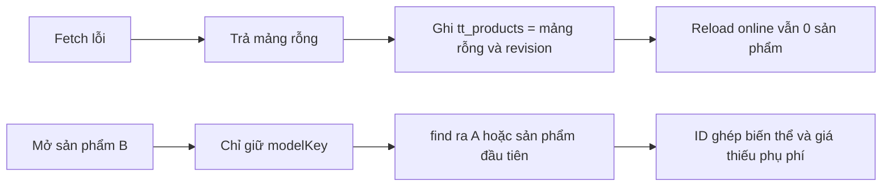
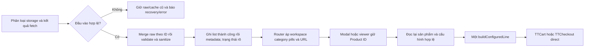

# BẢN CHỈ THỊ PHÊ DUYỆT KIẾN TRÚC & MÃ NGUỒN CHI TIẾT

Ngày ban hành: 21/10/2026. Đầu vào: CODEX BRIDGE do người dùng truyền trong stdin; đối chiếu với repository hiện tại.

🎯 **[Auto-Router]** Nhóm 5 — Kiểm định lỗi; kết hợp 3 — Web và 7 — Kiến trúc. Skill: fix-loop-breaker. Công cụ thực dùng: PowerShell, Node.js, rà soát độc lập bằng một agent chỉ đọc.

## 1. Quyết định có hiệu lực ngay

**PHÊ DUYỆT PHƯƠNG ÁN KHẮC PHỤC bên dưới để Antigravity triển khai ngay. CHƯA NGHIỆM THU bản hiện tại.** Các số 15/15, 26/26 và 6/6 không đủ bằng chứng kết luận luồng mua hàng, migration, XSS và giao diện đã đúng.

Giữ kiến trúc HTML/CSS/JavaScript hiện có. Đây là chỉ thị sửa và kiểm chứng; không phải quyết định phát hành production. Các yêu cầu dữ liệu và bảo toàn Admin trong chỉ thị cũ tiếp tục có hiệu lực, với các điều chỉnh rõ ở tài liệu này.

Phiên kiểm định này chỉ thêm tài liệu và probe trong `reports/` cùng `FIX-NOTES.md`; chưa áp bản vá vào mã ứng dụng. Không ghi đè CODEX_BRIDGE.md đang có thay đổi hay khôi phục codex_response.md đã bị xóa.

Không có công cụ Argon/Antigravity MCP khả dụng trong danh sách tool của phiên. Không suy diễn hai tài khoản hết hạn hoặc đã hội ý Argon. Báo cáo này là quyết định kiểm định của Codex, có thêm một lượt rà soát độc lập chỉ đọc.

## 2. Kết quả kiểm chứng và giới hạn bằng chứng

| Kiểm tra thực chạy | Kết quả |
|---|---|
| `node tests/test_behavior.js` | 15/15 đạt; exit 0 |
| `powershell.exe -NoProfile -ExecutionPolicy Bypass -File .\test_tab_architecture.ps1` | 26/26 đạt; exit 0 |
| `powershell.exe -NoProfile -ExecutionPolicy Bypass -File .\test_e2e_simulation.ps1` | 6/6 đạt; exit 0; script chỉ đối chiếu chuỗi/cấu trúc |
| `node --check` cho catalog-store, products-manager, app, admin, viewer3d, cart, checkout | Cả 7 file exit 0 |
| `node reports/codex-audit-2026-10-21/reproduce-audit.cjs` | Exit 0, xác nhận các vấn đề A–H trên snapshot cũ |
| Catalog/ảnh so với manifest | 55 bản ghi; 55 hash ảnh khớp manifest |

`reproduction.log` ghi kết quả và SHA256 các file liên quan. Probe dùng Node VM, DOM giả dựa trên ID thực trong index.html; không thay thế kiểm thử trình duyệt. Riêng ca H giải mã HTML entity rồi chạy handler trong VM để chứng minh ngữ cảnh JavaScript không an toàn; chưa phải thực thi payload trong browser.

Chưa có bằng chứng trực quan ở 360/768/1440 px, sáng/tối; chưa nghiệm thu WebGL, lịch sử trình duyệt thật, focus hay thao tác mobile. Playwright/Puppeteer/jsdom không cài trong project hiện tại. Worker dùng công cụ browser sẵn có ở môi trường của mình hoặc bổ sung harness phù hợp, rồi gửi bằng chứng thực.

**Đính chính bridge:** `js/cart.js` có alias tương thích `window.TTStore.addToCart = addToCart`. Trang chính tải cart.js trước viewer3d.js. Vì vậy, nhận định “TTStore không tồn tại nên nút bị vô hiệu hóa” không đúng với snapshot được kiểm định. Vẫn chuẩn hóa code mới dùng TTCart, giữ alias cho người gọi cũ.

## 3. Danh sách lỗi và yêu cầu xử lý

P1 trong bảng là lỗi chặn nghiệm thu. P2 cũng phải hoàn thành trong đợt sửa này vì ảnh hưởng trực tiếp yêu cầu Category Hub.

| Mã | Mức | Bằng chứng | Tác động / chỉ thị |
|---|---|---|---|
| F01 | P1 | products-manager.js:795 tìm `btn-modal-open-3d`; index.html:1513 là `order-modal-3d-btn` | Nút modal không ẩn cho mẫu thiếu model. Thống nhất ID và chặn cả hàm mở, không chỉ CSS. |
| F02 | P1 | viewer3d.js:416,431,525 chọn bằng modelKey rồi `products[0]`; :547 fallback nfc_wifi | Mua/hiển thị/báo giá sai sản phẩm. Probe E mua seed đầu tiên dù cả 55 mẫu không có model; probe F mở B nhưng mua A. |
| F03 | P1 | viewer3d.js:436 ghép ID sản phẩm với màu/vật liệu; :439 bỏ phụ phí | Giỏ dùng `id` làm Product ID, bỏ qua productId riêng; dòng từ viewer không đồng nhất với modal, có thể tính sai tiền và tách dòng trùng cấu hình. |
| F04 | P1 | catalog-store.js:287–298 trả [] khi fetch lỗi; :375–384,:493 ghi [] và marker | Storage mới gặp mất mạng thành catalog rỗng bền vững. Probe B: online reload vẫn 0 sản phẩm. Reset defaults cũng có nguy cơ xóa catalog khi fetch lỗi. |
| F05 | P1 | catalog-store.js:388–397 coi JSON sai kiểu là seed mới | Ghi đè dữ liệu gốc. Probe A: object bị thay bằng 55 seed. JSON null cũng phải phân biệt với key chưa tồn tại. |
| F06 | P1 | catalog-store.js:421–422 sanitize trước enrich; :318,:327 tự phục hồi [] | Che trạng thái trường thiếu, ghi sai category/ảnh/author/downloads; tự ghi đè mảng rỗng có chủ ý. Probe C cho category sai, ảnh logo, downloads 0. |
| F07 | P1 | products-manager.js:861,:881 đưa dữ liệu đã escapeHTML vào inline JS; cart.js render item; admin.js:235–267; app.js showToast | Escape HTML không bảo vệ chuỗi JavaScript trong onclick. Giỏ/Admin/toast còn nội suy dữ liệu vào innerHTML. Ca H xác nhận chuỗi màu có thể tạo lệnh chạy sau khi giải mã entity. |
| F08 | P2 | products-manager.js:198 stopPropagation ở tổ tiên nút swatch; listener ở :607 | Click màu bị chặn trước khi đến container delegation. Bỏ inline stopPropagation, xử lý return theo action ngay trong dispatcher. Chưa kiểm click bằng browser. |
| F09 | P2 | app.js:257 gọi switchWorkspace; :113–116 chỉ đổi hash, không render category | Category → Studio → Store: URL #store nhưng vẫn 1 Hero/danh mục. Probe G xác nhận. Reload đổi nội dung khác trạng thái trước reload. |
| F10 | P1 | importer:125–159,:269–277; products.json có dữ liệu sinh tương ứng | Tự tạo phụ phí 20k/25k/30k, màu bán, layer, bảo hành, chip NFC; trái hợp đồng nguồn và override. Phải sửa pipeline, không chỉ UI. |
| F11 | P1 | catalog-store.js:185–191 nuốt lỗi marker; :487 cập nhật cache trước ghi; :640–647 ghi tombstone trước list | Không có trạng thái commit tin cậy khi quota/marker lỗi; có thể báo/hiển thị dữ liệu chưa lưu. Trả trạng thái thất bại cụ thể, bảo toàn catalog cũ khi ghi list thất bại. |
| F12 | P2 | registry lặp ở catalog-store, products-manager, app, importer; chỉ pills Admin cập nhật chưa đủ | Registry có thể lệch; trường commercialStatus/license cần hiển thị và giữ qua sửa/import/export. Dùng một nguồn danh mục và validation thống nhất. |

Phát hiện bổ sung bắt buộc đưa vào đợt kiểm chứng:

- `products-manager.js:799` và ảnh giỏ/Admin đặt fallback mà không vô hiệu onerror: nếu ảnh fallback lỗi sẽ gọi lại. Modal gán `.src` từ hàm trả chuỗi đã escape HTML: URL có `&` có thể thành `&` sai khi dùng DOM property. Tách validation URL khỏi encoding theo ngữ cảnh.
- `viewer3d.js:423` dùng `prod.price || 109000`, biến giá 0 hợp lệ thành 109.000đ. Xóa giá dự phòng không có căn cứ.
- `quickAddToCart()` không chặn sản phẩm cần cá nhân hóa; `buildConfiguredLine()` dùng object modal đã giữ, chưa đọc lại sản phẩm active từ store khi submit. Kiểm tra lại trạng thái, biến thể và giá hiện hành trước commit.
- `sanitizeProduct()` mặc định điểm 5/5 và selectionScore 100; Hero dùng `selectionScore || 92`. Thiếu điểm phải hiển thị chưa có dữ liệu, giữ điểm 0 nếu hợp lệ theo hợp đồng; không tạo điểm tuyển chọn.
- Importer làm tròn selectionScore ở :262, chưa kiểm toàn bộ miền số/path/khả năng giải mã ảnh, và copy ảnh trong vòng lặp trước khi validation toàn bộ xong. Hoàn thành preflight trước bất kỳ thay đổi catalog/asset chính nào.
- SchemaVersion đã là 5; products.json thực tế đã 55. Các mô tả “6 sản phẩm, schema 4” thuộc hiện trạng cũ, không dùng làm baseline của đợt sửa này.

Không tuyên bố bảng này bao phủ mọi lỗi có thể tồn tại. Các phát hiện có bằng chứng khác nhau: tái hiện VM, phân tích mã, và phần phải kiểm browser được ghi tách biệt.

## 4. Luồng hiện tại và luồng được duyệt





Nguyên nhân gốc: trạng thái “không có dữ liệu” bị trộn với “đọc lỗi”; định danh sản phẩm bị trộn với định danh hình học/biến thể; encoding HTML bị dùng cho JavaScript; điều hướng có nhiều đường áp state không đồng nhất. Xóa các fallback và đường vòng đó trước khi tối ưu hoặc thêm tính năng.

Lượt rà soát độc lập đồng thuận về lỗi fetch/storage, raw migration, router và XSS Admin. Không có bất đồng kỹ thuật còn tồn tại cần chọn theo độ tự tin. Hai nhận định khác nhau trong bridge — thiếu TTStore và test xanh đủ nghiệm thu — bị loại bằng alias thực tế và probe tái hiện.

## 5. Hợp đồng mã nguồn bắt buộc

### 5.1 Catalog: phân loại đầu vào trước migration

Áp dụng đoạn lõi sau hoặc tương đương có cùng hành vi; không dùng parsed === null để đại diện cả absent và JSON null:

```js
function readStoredCatalog(storage) {
  let raw;
  try { raw = storage.getItem('tt_products'); }
  catch (error) { return { kind: 'unavailable', error }; }
  if (raw === null) return { kind: 'absent' };
  try {
    const products = JSON.parse(raw);
    return Array.isArray(products)
      ? { kind: 'array', raw, products }
      : { kind: 'invalid', raw, reason: 'wrong-type' };
  } catch (error) {
    return { kind: 'invalid', raw, reason: 'invalid-json', error };
  }
}

async function fetchDefaultCatalogResult(url) {
  try {
    const response = await fetch(url);
    if (!response.ok) throw new Error(`Catalog HTTP ${response.status}`);
    const raw = await response.json();
    // validateWholeCatalog kiểm tra cả mảng, duplicate ID và nested fields.
    // Không filter bỏ âm thầm bản ghi lỗi rồi đánh dấu revision thành công.
    const products = validateWholeCatalog(raw);
    return { ok: true, products };
  } catch (error) {
    return { ok: false, error };
  }
}
```

`validateWholeCatalog` là hàm phải triển khai trong store và dùng chung cho fetch/save/import; không giả định đang tồn tại. ID/title hợp lệ, giá safe integer không âm, nested colors/materials/specs đúng kiểu, số liệu hữu hạn/đúng miền, ID sản phẩm/biến thể không trùng. Bản ghi legacy cần được nhận diện và migrate có báo cáo, không tự bỏ để đạt 55.

Quy tắc trạng thái:

1. Absent + fetch thành công: seed đủ catalog đã xác thực.
2. Array []: giữ rỗng có chủ ý.
3. Array có dữ liệu + fetch lỗi: dùng catalog đã lưu; không nâng revision. Cho retry tải nguồn mà không mắc Promise lỗi vĩnh viễn.
4. Absent + fetch lỗi: error/retry; không ghi tt_products=[] và không ghi marker.
5. Invalid hoặc unavailable: giữ raw, recovery/error; không cho CRUD hoặc autosave âm thầm ghi đè dữ liệu hỏng. Nếu hiển thị bản mặc định tạm phải phân biệt rõ chưa khôi phục storage.
6. Reset defaults chỉ chạy khi fetch và validation thành công; thất bại giữ nguyên dữ liệu trước reset.

Migration merge trên bản ghi raw trước sanitize. Phân biệt trường không tồn tại với giá trị []/0/false/null theo hợp đồng từng trường; `modelKey:null` có nghĩa chưa có model, không tự phục hồi model khác. Cụm ảnh `image/imageSource/presetId/imageAlt` được giữ cùng nhau; image data raster cũ không biến thành preset.

Hàm buildMigration không đọc clock/storage/global cache; nhận revision, baseline và timestamp từ input nếu cần. Trả `{products, metadata, changed, report}`; report mô tả thêm/giữ/tombstone/lỗi. Không đổi migratedAt mỗi lần chạy khi không có migration.

Ghi list trước, metadata sau; không coi hai setItem là giao dịch nguyên tử. Nếu list ghi lỗi, cache cũ và trạng thái chưa lưu phải giữ đúng. Nếu metadata lỗi sau list đã lưu, phản ánh `metadataPending`, không báo hoàn tất; retry cùng snapshot không nhập trùng seed và không ghi lại list nếu chuỗi không đổi. `writeMetadata()` phải trả lỗi cho caller, không chỉ console.warn.

Xóa seed: dựng nextProducts và nextMetadata riêng, không mutate cachedMetadata trước commit. Nếu list thất bại, không tạo tombstone báo xóa thành công; nếu metadata thất bại, báo trạng thái pending và cho retry. Metadata, storage event và các API hiện tại tiếp tục tương thích. Không ghi ngược storage từ listener.

Khi Admin bắt đầu chỉnh sửa, giữ baseline/version; trước lưu đối chiếu bản mới nhất. Nếu tab khác đổi cùng bản ghi, giữ form và báo conflict thay vì ghi đè. Đối chiếu lại ngay trước commit; localStorage không cung cấp compare-and-swap, không tuyên bố cơ chế đó là giao dịch nhiều tab nguyên tử.

### 5.2 Viewer: Product ID là nguồn duy nhất của hành động mua

Viewer sở hữu `activeViewerProductId`, ban đầu null. Một registry hình học liệt kê các modelKey thực sự hỗ trợ, dùng cho cả launcher và viewer. Không chỉ kiểm chuỗi modelKey khác rỗng.

```js
let activeViewerProductId = null;

function resolveActiveViewerProduct() {
  if (!activeViewerProductId) return null;
  const product = window.TTCatalogStore
    .getProductByIdSync(activeViewerProductId);
  return product && product.status === 'active' &&
    modelRegistry.has(product.modelKey) ? product : null;
}
```

`modelRegistry` phải được khai báo từ những geometry hiện có, không tạo model mới cho 55 mẫu. Mở productId không tồn tại, archived/draft, modelKey null hoặc modelKey lạ phải từ chối trước switchWorkspace/load; toast rõ, không tải nfc_wifi thay thế. `open3DFromModal()` kiểm lại điều kiện và chỉ đóng modal khi mở viewer thành công.

Mở sản phẩm hợp lệ: đặt ID trước updateActionBar; chuyển workspace và nạp geometry từ đúng product.modelKey. Không suy ngược ID từ geometry. Model tab chọn mẫu demo trực tiếp phải xóa activeViewerProductId, trừ khi tab mang Product ID được ánh xạ tường minh và hợp lệ. Demo vẫn xem được nhưng không có giá/nút mua gán cho một sản phẩm ngẫu nhiên.

Tất cả updateActionBar/add/requestQuote dùng resolveActiveViewerProduct. Không có sản phẩm thì xóa title/giá cũ và disabled nút mua thật bằng thuộc tính disabled. Báo giá demo có thể ghi “mẫu hình học tham khảo”, không gán Product ID thương mại. Theo dõi tt_products_updated để vô hiệu hóa khi Admin ẩn/xóa hoặc thay model; submit vẫn đọc lại lần cuối.

Lối triển khai an toàn được duyệt cho đợt này: CTA từ viewer mở modal cấu hình đúng Product ID trước khi thêm giỏ; đổi nhãn thành “Chọn cấu hình & thêm giỏ” để đúng hành vi. Chuyển màu preview sang cấu hình mua chỉ khi ánh xạ được vào colors thực của sản phẩm. Không biến mọi màu PBR thành màu xưởng cung cấp. Nếu giữ quick-add ở viewer, chỉ được dùng builder chung với cấu hình đã xác thực đầy đủ; mọi trường hợp cần nhập liệu đều chuyển modal.

Giữ `id: product.id` trong dòng hàng. Tuple biến thể do TTCart.buildLineId hiện có xử lý; không đặt `id = productId-color-material`. Không dùng nhánh products[0] trong action bar, purchase hay quote. Giá 0 được giữ đúng.

### 5.3 Dựng dòng hàng: một hợp đồng cho mọi điểm mua

Trích xuất builder khỏi biến global modal thành hàm nhận productId + cấu hình; modal/card/viewer gọi cùng nguồn. Có thể đặt trong `js/purchase-config.js` và nạp trước các caller. Không đưa logic render hoặc storage vào builder.

```js
// Contract; validateConfiguration là phần Worker phải triển khai.
function buildConfiguredLine(productId, configuration) {
  const product = window.TTCatalogStore.getProductByIdSync(productId);
  if (!product || product.status !== 'active') {
    throw new Error('Sản phẩm không còn khả dụng.');
  }
  // Lấy option theo ID từ catalog hiện hành, không tin object/giá do UI truyền.
  const { color, material, qty, customText } =
    validateConfiguration(product, configuration);
  const unitPrice = product.price + material.priceModifier;
  if (!Number.isSafeInteger(unitPrice) || unitPrice < 0) {
    throw new Error('Giá cấu hình không hợp lệ.');
  }
  return {
    id: product.id, title: product.title, image: product.image,
    category: product.category, price: unitPrice, qty,
    color, colorId: color.id, colorName: color.name,
    material, materialId: material.id,
    materialName: material.label || material.name,
    customText: customText || null
  };
}
```

Validation gồm qty nguyên 1–99, giá và phụ phí hữu hạn safe integer, option thuộc sản phẩm, yêu cầu cá nhân hóa đã đáp ứng. Thêm metadata yêu cầu cấu hình theo nguồn/override cụ thể và bảo toàn qua sanitizer/Admin; không coi mọi sản phẩm trong category NFC cần cùng trường hoặc đều có chip.

Nếu chưa có cấu hình bán đã xác minh thì mở modal/thông báo cần cấu hình xưởng; không tạo màu/vật liệu/phụ phí để cho phép mua. Không dùng fallback black/PLA dưới danh nghĩa biến thể đã bán. Sản phẩm đơn biến thể có thể dùng một biến thể “Tiêu chuẩn” khi được cấu hình rõ trong override.

`quickAddToCart()` phải gọi modal khi cấu hình còn thiếu. `TTCart.addToCart()` cũng validate hợp đồng tối thiểu tại boundary, không nhận ID rỗng, qty sai kiểu hoặc giá NaN. Tổng tiền và ship do TTCheckout.calculateOrderTotals tính. Loại công thức dự phòng sai trong cart.js nếu checkout chưa sẵn sàng; báo loading/error thay vì hiển thị tổng sai.

Direct: `TTCheckout.openCheckout([line], 0, {source:'direct'})`, không mutate giỏ đang có. Cart: `TTCart.addToCart(line)`. Khi thiếu API, giữ modal/cấu hình và báo lỗi; không đóng modal rồi im lặng.

### 5.4 DOM và sự kiện

Thống nhất `order-modal-3d-btn`; khi sản phẩm không hỗ trợ model, set `hidden = true`, `disabled = true` và loại khỏi focus. Kiểm tra CSS hiện có không ghi đè thuộc tính hidden.

Loại dữ liệu động khỏi inline onclick: modal color/material, cart +/-/xóa, Admin edit/delete/preset và các handler nhận ID/tên. Dùng createElement, textContent, dataset và listener/delegation. Dữ liệu text không đi qua escapeHTML trước khi gán textContent hoặc .src.

```js
const button = document.createElement('button');
button.type = 'button';
button.dataset.action = 'select-color';
button.dataset.colorId = color.id;
button.textContent = color.name;
// Listener đọc dataset rồi tra option từ sản phẩm hiện hành.
```

Xóa onclick stopPropagation của hàng swatch; xử lý action và return trong container listener trước card mở detail. Không đăng ký listener lần hai sau mỗi render.

showToast ở app/Admin phải đặt message bằng textContent; icon có thể là DOM/static markup tin cậy. Cart và Admin overview/order list cũng áp dụng cùng nguyên tắc. `encodeURIComponent` không phải cách làm an toàn cho ID nằm trong chuỗi inline JavaScript.

URL validator trả URL nguyên vẹn, không escape HTML. Chấp nhận scheme/path được khai báo rõ; từ chối javascript, SVG data và data không phải ảnh raster hợp lệ. Upload mới phải giải mã ảnh và kiểm MIME/kích thước; dữ liệu legacy lỗi được báo cần xử lý, không tự xóa raw gốc. Hex chỉ nhận 3/4/6/8 chữ số; regex `{3,8}` hiện nhận cả độ dài không hợp lệ.

Image fallback chỉ chạy một lần, vô hiệu onerror trước gán src. Bao phủ card/Hero/modal/cart/Admin. Không gắn lại handler gây vòng lặp nếu fallback thất bại.

### 5.5 Router và category

Một dispatcher sở hữu normalize/validate → apply workspace → apply category/pills → ghi history tối đa một lần. `pushState` không phát hashchange nên phải apply ngay. popstate/hashchange chỉ apply state, không push lại; cùng URL/state không lặp render hoặc history vô ích.

Quyết định UX cho đợt này: **bấm tab Store đưa về Tất cả**, URL #store, 5 khối nếu đủ catalog. Back/Forward phục hồi category của entry trước. Nếu về Store bằng deep link category thì áp đúng URL đó. Loại return sớm khiến same-view bỏ qua state update.

Giữ aliases, 4 workspace, wrapper renderStoreProducts(filter). Init bất đồng bộ dùng URL mới nhất sau await. Không để render cũ ghi đè route người dùng vừa chọn. Category registry dùng từ TTCatalogStore hoặc module shared nạp trước các caller; importer đọc nguồn JSON registry chung. Không duy trì 4 danh sách category độc lập.

Lọc/tìm kiếm kết hợp category, tiếng Việt không dấu, tên và Model ID. Hiển thị loading/error/empty riêng; không gộp lỗi tải thành “không có sản phẩm”. Trong All, bổ sung khu “Bộ sưu tập đã lưu” cho legacy/custom có category ngoài registry; không âm thầm làm chúng biến mất và không ép vào nhóm mới.

### 5.6 Importer, seed và metadata Admin

Loại suy diễn layer/warranty/NFC/biến thể/phụ phí trong importer. Tạo overrides theo Model ID, mỗi giá trị bán cần nguồn cấu hình rõ; recommendation vẫn chỉ là recommendation. Giữ selectionScore chính xác từ công thức, chỉ làm tròn khi render. Giữ đủ trạng thái thương mại gốc: 50 Chua_ro, 4 Can_mua_giay_phep, 1 Da_xac_minh; không đổi trạng thái để mở bán.

Preflight toàn bộ nguồn: 55 unique ID, 11/category, số liệu đúng miền, đúng 5 Hero, giải mã 55 ảnh, hash, đường dẫn nằm trong đích cho phép. Chỉ sau khi mọi kiểm tra đạt mới stage/copy và replace catalog/manifest. Dry-run không thay file. ID phải được chuẩn hóa trước kiểm trùng và trước tạo đường dẫn để tránh kiểu int/string hoặc đường dẫn nguồn bất thường.

Lưu baseline seed hiện tại làm fixture trước chỉnh importer. Seed mới dùng catalogRevision mới, ví dụ mw-55-v2; schemaVersion giữ 5 nếu cấu trúc vẫn tương thích. Không reimport cùng revision để âm thầm sửa sản phẩm Admin. Với dữ liệu sai đã lưu từ v1, chỉ sửa trường xác định được là giá trị do importer sinh chưa bị sửa theo baseline/provenance; trường không rõ nguồn gốc phải giữ và báo danh sách cần rà soát. Không xóa hàng loạt specs/materials của Admin.

Không đánh đổi bảo toàn dữ liệu lấy đúng 55 bản ghi. 55 chỉ là catalog seed sạch; cache có legacy/Admin có thể nhiều hơn. Lưu metadata thương mại, author/URL/modelId/thống kê qua init/edit/export/import; Admin hiển thị license/commercialStatus để kiểm được. Import validate toàn bộ trước commit, có báo lỗi cụ thể và không thay phần hợp lệ trong khi bỏ phần lỗi.

Đồng bộ asset version cho index/admin khi sửa để browser tải code mới. Hiện cả hai đang dùng ?v=3.1; cùng version giữa trang chưa đủ nếu cache phiên cũ còn giữ JS đã thay đổi.

## 6. Kiểm thử bổ sung — bắt buộc thất bại trên bản cũ

Chuyển các hiện tượng A–H thành regression assertions về hành vi ĐÚNG, không giữ probe xác nhận lỗi làm cổng xanh của bản sửa. Probe trong report chỉ là bằng chứng snapshot cũ, dự kiến không còn đạt các assertion lỗi sau khi sửa.

| Nhóm | Ca nghiệm thu và kết quả phải đo |
|---|---|
| Fetch/storage | Storage mới + mất mạng: 0 write catalog/marker; retry online nạp đủ 55. Reset mất mạng không đổi catalog. |
| Storage sai kiểu | JSON hỏng, object, chuỗi, số, null: raw không đổi; recovery rõ. [] vẫn []. |
| Migration | Merge raw seed thiếu metadata ra đúng category/ảnh/thống kê; giữ giá/tên riêng, []/0/false và cụm ảnh upload. Không đổi legacy thành MakerWorld. |
| Reload/idempotence | VM/context mới dùng storage lần trước; chạy hai lần dữ liệu/metadata không đổi, đếm write bằng 0 lần hai. Không gọi lại cùng initPromise rồi tuyên bố migration đã chạy lại. |
| Tombstone | Xóa seed, reload context mới và nâng revision fixture: seed không xuất hiện lại. Kiểm cả import/reset theo hợp đồng riêng. |
| Quota/marker | Inject lỗi từng setItem; list lỗi không đổi cache cũ/tombstone; marker lỗi báo pending, retry không nhân seed hoặc ghi list dư. |
| Viewer | Mở B cùng modelKey với A: title, giá, cấu hình và cart id đều B; id không ghép. Mẫu null/key lạ/archived không mở nhầm; demo không mua seed đầu tiên. |
| Giá/cấu hình | Base 109k + 20k × 3 = 387k; giá 0 giữ 0; option không thuộc sản phẩm bị chặn. Cá nhân hóa thiếu không quick-add. Admin sửa/ẩn khi modal mở phải được kiểm lại. |
| Direct/cart | Giỏ B giữ nguyên khi direct A; cùng tuple từ card/modal/viewer gộp đúng; khác customText tách đúng. 310k giảm 10% → 279k + ship25k =304k; giỏ rỗng ship0. |
| Router | Category → Studio → Store: #store và 5 khối; Back/Forward đúng; reload/deep link/category lạ/init chậm; 1 click tối đa 1 entry. |
| Sự kiện | Click swatch thật thay nhãn/active và cấu hình mua, không mở card; Hero có 1 bản/nhóm, không trùng grid. |
| XSS/ảnh | Payload ở ID/title/specs/color/material/customText/URL qua import, modal, giỏ, toast, Admin; browser không thực thi. URL có & tải đúng; fallback lỗi dừng sau 1 lần. |
| Admin | Sửa một trường không mất metadata; import/export roundtrip; sửa đồng thời hai tab không âm thầm ghi đè; ẩn/thêm đổi số lượng UI. |

Test browser phải chạy qua web server phục vụ index.html, không chạy file://. Dùng dữ liệu thử và storage cô lập; không xóa localStorage người dùng đang dùng. Tại 360/768/1440 px, cả sáng/tối: không tràn ngang body, CTA nhìn thấy/bấm được, dock không che thao tác, focus/keyboard/Escape ổn, không lỗi console mới/thumbnail hỏng. Kiểm WebGL trên môi trường có hỗ trợ; môi trường không có thì ghi rõ chưa nghiệm thu phần đó.

Rà soát reduced-motion cho chuyển cảnh và cuộn tự động; không chờ animation để apply state. Thực hiện kiểm thử âm trên snapshot cũ trong thư mục/worktree riêng; không đảo mã ứng dụng đang có thay đổi để chứng minh test fail.

Các lệnh nền phải chạy riêng và ghi exit code từng lệnh:

```powershell
node tests/test_behavior.js
powershell.exe -NoProfile -ExecutionPolicy Bypass -File .\test_e2e_simulation.ps1
powershell.exe -NoProfile -ExecutionPolicy Bypass -File .\test_tab_architecture.ps1
node --check js/catalog-store.js
node --check js/products-manager.js
node --check js/app.js
node --check js/admin.js
node --check js/viewer3d.js
node --check js/cart.js
node --check js/checkout.js
```

Thêm lệnh check cho module mới và lệnh browser vào báo cáo. Không dùng Next build làm bằng chứng thay cho ứng dụng static thực tế đang phục vụ.

## 7. Thứ tự Worker thực hiện và cổng bàn giao

1. Lưu diff/hash hiện có và baseline seed; cập nhật FIX-NOTES/SPEC theo chỉ thị, không stash/commit công việc người dùng tự ý. Ghi ca lỗi và expected result trước sửa.
2. Thêm test thất bại đúng ca A–H và các failure injection; lưu kết quả bản cũ.
3. Sửa phân loại storage/fetch, raw migration, commit trạng thái, conflict và validation. Chứng minh không mất dữ liệu trước làm UI.
4. Sửa importer/override/revision và pipeline ảnh; xác minh seed sạch, manifest cùng quy tắc bảo toàn cache v1.
5. Sửa shared purchase builder, viewer ID/model guard, modal ID; tích hợp TTCart/checkout đúng hợp đồng.
6. Sửa renderer và delegation ở Store/modal/cart/Admin/toast; sửa router/registry và các state UI.
7. Chạy kiểm thử nền, browser, kiểm thử âm; báo bằng kết quả thực, ảnh và log.

Bảng Hero seed sạch phải tiếp tục đúng: Trang_Diem_Vanity=1646129; Decor_Den_Noi_That=1438306; Do_Choi_Moc_Khoa=1702306; Hop_De_Ban_Tien_Ich=1971424; Ca_Nhan_Hoa_NFC=1836100. Khi Admin đổi catalog thì UI đếm và chọn đại diện theo dữ liệu active, không hardcode 11 hay giữ Hero đã ẩn.

Báo cáo bàn giao cần: file/diff thay đổi; revision và manifest; report migration cho cache sạch/legacy/Admin/lỗi; bảng từng lệnh và exit code; kết quả regression fail trước/pass sau; ảnh 6 tổ hợp viewport/theme; log browser/console/network; ca chưa chạy và lý do; giới hạn bảo toàn dữ liệu còn lại.

**Antigravity được triển khai ngay trong phạm vi trên. Chỉ được đề nghị nghiệm thu khi ca lỗi ban đầu đã hết, các cổng bắt buộc đạt và có bằng chứng trình duyệt. Nếu chưa chạy được một cổng, báo đúng trạng thái chưa kiểm; không thay bằng lời khẳng định “fully verified”.**
