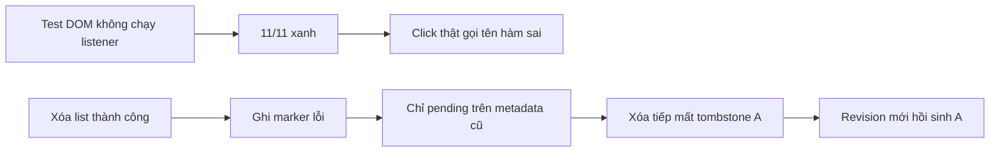

# BẢN CHỈ THỊ PHÊ DUYỆT KIẾN TRÚC & MÃ NGUỒN CHI TIẾT — TÁI THẨM ĐỊNH

Ngày: 21/10/2026. Đầu vào: báo cáo Antigravity F01–F12 do người dùng truyền qua stdin. Đối tượng: working tree hiện tại, có thay đổi chưa commit.

🎯 **[Auto-Router]** Nhóm 5/3/7 — kiểm định lỗi, Web, kiến trúc | Skill: fix-loop-breaker | Công cụ thực dùng: PowerShell, Node.js, một agent rà soát độc lập chỉ đọc.

## 1. Quyết định có hiệu lực ngay

**PHÊ DUYỆT KIẾN TRÚC KHẮC PHỤC tại tài liệu này để Antigravity thực thi ngay. CHƯA NGHIỆM THU bản hiện tại; chưa cho phép kết luận F01–F12 hoàn tất hoặc phát hành bản này.**

Giữ ứng dụng HTML/CSS/JavaScript hiện có, Product ID ổn định, builder mua hàng dùng chung và raw merge trước sanitize. Không viết lại toàn bộ hệ thống. Chỉ thị trước tại `CHI_THI_ANTIGRAVITY.md` vẫn có hiệu lực; tài liệu này bổ sung bằng chứng mới và chốt cách sửa các điểm chưa đạt.

Phiên thẩm định chỉ thêm tài liệu/probe trong reports và ghi chú kiểm định. Chưa sửa mã ứng dụng, chưa giao lệnh qua Antigravity MCP. Không có tool Argon/Antigravity/Chrome DevTools MCP khả dụng trong phiên; không suy diễn tài khoản đã hết hạn. Tuyên bố browser PASS trong stdin là báo cáo của Worker, chưa được xác minh độc lập ở phiên này.

## 2. Bằng chứng thực chạy và giới hạn

| Lệnh | Kết quả quan sát |
|---|---|
| `node tests/test_audit_regressions.js` | 11/11 đạt, exit 0 |
| `node tests/test_behavior.js` | 15/15 đạt, exit 0 |
| `powershell.exe -NoProfile -ExecutionPolicy Bypass -File .\test_tab_architecture.ps1` | 26/26 đạt |
| `powershell.exe -NoProfile -ExecutionPolicy Bypass -File .\test_e2e_simulation.ps1` | 6/6 đạt |
| `node --check` trên catalog-store/purchase-config/products-manager/app/admin/viewer3d/cart/checkout | 8/8 đạt |
| `node reports/codex-audit-2026-10-21/recheck-current.cjs` | Tái hiện 9 vấn đề trên mã hiện tại; log tại `recheck-current.log` |

Hai script PowerShell kiểm tra chuỗi/cấu trúc mã, không thực hiện tương tác E2E trong browser. Regression mới dùng DOM giả; `addEventListener` của node không lưu callback, `appendChild` không xây DOM. Ca E/F không nạp purchase-config.js và còn thay switch3DModel bằng stub, nên không kiểm đường mua với builder mà trang thật đang nạp. Ca H chỉ kiểm một vùng modal, không bao phủ cart/Admin hoặc thực thi HTML trong browser.

Probe mới dùng production source trong Node VM; với orders renderer chỉ thêm một export để gọi đúng hàm, không thay thân hàm. Probe XSS xác nhận dữ liệu đi vào HTML không escape; chưa tuyên bố đã thực thi payload trong browser. Probe exit-code quan sát đối tượng process trong VM khi cưỡng bức 11 assertion fail, không phải một tiến trình CI thật.

SHA256 các file ứng dụng/test/fixture đã đối chiếu được lưu tại `recheck-snapshot-hashes.json`; dùng để xác định snapshot, không gán kết quả kiểm định cho các thay đổi sau đó.

`recheck-current.cjs` xác nhận sự tồn tại của lỗi, **không dùng exit 0 của nó làm cổng phát hành**. Worker phải chuyển mỗi ca thành assertion hành vi đúng, thất bại trên snapshot hiện tại và đạt sau sửa.

## 3. Đối chiếu F01–F12

| Hạng mục | Kết luận trên snapshot hiện tại |
|---|---|
| F01 | Modal đã dùng ID đúng, ẩn/disable và chặn model null. Card vẫn chỉ kiểm modelKey khác rỗng ở products-manager.js:162, chưa kiểm registry. Chưa đóng kiểm chứng browser/focus. |
| F02 | Đã giữ activeViewerProductId và bỏ fallback products[0]. Chưa hoàn tất demo reset, palette mapping và thay model sau cập nhật catalog. |
| F03 | Có builder và cộng phụ phí, giữ Product ID. Vẫn có 3 nhánh builder dự phòng, quantity parseInt sai hợp đồng, tự tạo option và thiếu kiểm boundary cart. |
| F04 | Fresh offline không ghi []; online reload nạp được seed. Chuỗi offline migration rồi mutation vẫn có thể persist revision quá sớm, làm mất phục hồi seed. |
| F05 | Init giữ raw JSON sai kiểu và chặn save khi storage invalid/unavailable. Chưa chứng minh UI recovery rõ và validation toàn bộ đường save/import. |
| F06 | Raw merge trước sanitize đã sửa ca title/price thiếu metadata. Vẫn cần kiểm cụm ảnh, null/[]/0/false, provenance migration và idempotence context mới. |
| F07 | Modal option và toast đã đổi sang DOM; một số action chuyển delegation. Cart, Admin overview/orders còn HTML thô; chưa đạt. |
| F08 | Đã bỏ stopPropagation inline trên swatch và sửa hex regex. URL raw còn được chèn vào HTML card/Hero, fallback cart/overview chưa chặn vòng lặp; cần kiểm click thật. |
| F09 | Category → Studio → Store đạt. Bấm lại Store ngay trong category vẫn giữ category và 1 Hero; chưa đạt yêu cầu reset all. |
| F10 | Có baseline fixture và hoãn copy tới cuối vòng kiểm tra. Vẫn round(score,2), tự sinh cấu hình/phụ phí/layer/warranty/NFC, chưa giải mã ảnh; chưa đạt. |
| F11 | List ghi trước metadata, saveProducts cập nhật cache sau list write. Metadata lỗi vẫn trả true, mất tombstone pending và chưa có phục hồi bền vững; chưa đạt. |
| F12 | Admin bảng sản phẩm đọc registry trung tâm và hiển thị commercialStatus/licenseName. Storefront, router, importer vẫn giữ danh sách riêng; chưa đạt. |

## 4. Những lỗi chặn nghiệm thu đã xác định

P1: chặn nghiệm thu; P2: vẫn phải hoàn thành trong phạm vi đợt này.

| Mã mới | Mức | Vị trí và bằng chứng | Hành vi phải đạt |
|---|---|---|---|
| R01 | P1 | cart.js:284,290 gọi `updateQty`; hàm thật là `updateItemQty`, alias chỉ tồn tại ở TTCart.updateQty:376. Click VM gây ReferenceError. | +/- chạy đúng một lần, đúng tuple; không lỗi console. |
| R02 | P1 | admin.js:682–690 dùng `ordersBody`; biến trong hàm là `tableBody`:623. Một đơn hàng đủ gây ReferenceError. | Renderer/delegation dùng tableBody, chi tiết mở đúng đơn, không đăng ký trùng. |
| R03 | P1 | cart.js:232–243 chèn image/title/colorName/materialName/customText thô; admin.js:207–213 và 649–656 chèn product/customer/order text thô. Probe thấy markup payload nguyên vẹn trong cart HTML. | Text qua textContent; URL qua validator rồi .src; không có dữ liệu không tin cậy trong HTML/JS/CSS attribute. |
| R04 | P1 | catalog-store.js:803–809 metadata fail vẫn true, chỉ đánh pending trên metadata cũ. Xóa A fail marker, xóa B thành công: tombstones chỉ có B; migration revision mới hồi sinh A. | Pending giữ nguyên đầy đủ next metadata; retry/reload không hồi sinh A/B; caller nhận kết quả commit. |
| R05 | P1 | catalog-store.js:539–544,615–628 và deleteProduct:794–803. Offline catalog cũ 1 record → upsert → delete ID không tồn tại → online init(true): vẫn 1/55. | Offline không nâng marker; retry online bổ sung seed hợp lệ theo tombstones và bảo toàn custom data. |
| R06 | P1 | purchase-config.js dùng parseInt qty; 1.5 thành 1, '2junk' thành 2. colors/materials rỗng vẫn tạo default. cart.js:89–115 nhận ID rỗng, giá âm, qty lẻ. | Boundary từ chối dữ liệu sai trước mutate/write; không tự chế biến thể bán. |
| R07 | P1 | importer:266–274 sinh specs/options, :303 vẫn `round(score,2)`; :244–254 chỉ tồn tại file/hash, không decode; :333 revision vẫn v1. | Sửa pipeline và revision/provenance đúng hợp đồng; ảnh phải decode trước publish. |
| R08 | P1 | test_audit_regressions.js bắt lỗi từng test, failed++, chỉ in summary, không exit nonzero. Cưỡng bức lỗi cho kết quả 0/11 nhưng process exitCode vẫn 0. | Bất kỳ fail nào làm runner exit != 0; kiểm bằng tiến trình thật. |
| R09 | P2 | app.js:86–108 đọc hash category trước rồi same-view return. Category → click Store: hash vẫn category, 1 Hero. | Click tab Store áp category=all và #store, kể cả same-view. |
| R10 | P2 | products-manager.js:11, app.js:13, importer:36 giữ registry/danh sách riêng. | Một nguồn category có thẩm quyền, mọi consumer và option UI đồng bộ. |

Ngoài ra: `saveProducts()` hiện chỉ map sanitize, không gọi validateWholeCatalog; import Admin gọi thẳng saveProducts (admin.js:735). Không chấp nhận biến dữ liệu lỗi thành giá 0 hoặc trùng ID rồi báo nhập thành công. Chưa thấy kiểm conflict khi form Admin mở lâu và tab khác đã sửa cùng sản phẩm.

## 5. Nguyên nhân gốc, lựa chọn kiến trúc và luồng

Sự thật: các test hiện tại bỏ qua click listener/builder thật và lỗi commit từng phần; trạng thái dữ liệu, nguồn seed và kết quả persistence chưa có hợp đồng chung. Giả định bị bác bỏ: test xanh đồng nghĩa luồng người dùng đúng; HTML escape helper tồn tại đồng nghĩa mọi sink an toàn; list trước metadata đồng nghĩa atomic.

Rà soát độc lập chỉ đọc đồng thuận về mất tombstone, marker offline, registry và exit code. Reviewer gợi ý envelope hoặc journal; chọn **journal phục hồi với hai key hiện có** để giữ tương thích dữ liệu, API facade và listener. Không gọi hai setItem là giao dịch nguyên tử. Không cần đổi framework hay thêm backend để sửa các lỗi đã đo.

```mermaid
flowchart LR
  A[Phân loại storage và trạng thái nguồn] --> B[Recovery journal trước migration]
  B --> C[Raw merge và validate toàn bộ]
  C --> D[Prepare journal và commit list]
  D --> E[Commit metadata hoặc giữ pending bền vững]
  E --> F[API trả trạng thái và UI hiển thị đúng]
  F --> G[Route state và Product ID]
  G --> H[Builder chung đọc catalog hiện hành]
  H --> I[Validate boundary và render DOM an toàn]
```





## 6. Thiết kế và thay đổi mã được phê duyệt

### 6.1 Ưu tiên 1 — test runner và hai lỗi callback

Trong regression runner, sau summary thêm `if (failed > 0) process.exitCode = 1;`. Giữ catch ngoài cùng cho lỗi runner. Tạo bản sao tạm hoặc flag test có kiểm soát làm một assertion fail; chạy Node bằng process thật, lưu exit code. Không sửa assertion để che lỗi sản phẩm.

Trong cart dispatcher gọi `updateItemQty(lId, -1/1)`; không tạo một biến global chỉ để che sai tên. Admin orders dùng `tableBody` xuyên suốt và guard delegation trên chính node đó. Test phải dispatch click sau ít nhất hai lần render và xác nhận mỗi click đổi qty đúng 1/mở đúng một lần.

### 6.2 Ưu tiên 2 — tất cả sink dữ liệu và ảnh

Thay renderer dòng cart, Admin overview và orders bằng DOM: createElement/textContent/dataset. Header/icon tĩnh có thể giữ template tin cậy. Không chỉ thêm escapeHtml rồi để các trường cũ tiếp tục nội suy. Không đưa dữ liệu vào chuỗi inline event handler.

URL validator chỉ trả URL raw; gán `.src` sau khi node được tạo. Card/Hero hiện nội suy `${safeImage}` trong HTML (products-manager.js:169 và renderer Hero), vì vậy đổi cả hai chỗ sang gán src bằng DOM hoặc encode đúng ngữ cảnh attribute nếu còn giữ template. Validator phải phân tích scheme/path theo allowlist và từ chối dữ liệu không hợp lệ; không dùng HTML escape làm URL validator. Mỗi image fallback chỉ chạy một lần: tắt onerror trước đổi src; áp dụng cả cart/overview/preset.

Payload kiểm tra: dấu nháy trong ID/URL, `` trong title/customText/customer.name/materialName, SVG data URL, URL raster hợp lệ có `&`. Browser phải hiển thị text nguyên nghĩa, không tạo node từ payload, không đặt cờ payload, không lặp request fallback khi cả ảnh gốc và fallback lỗi.

### 6.3 Ưu tiên 3 — persistence, retry và conflict

Tập trung mọi mutation/seed/migration/reset vào một service commit snapshot. Không để delete/reset có giao thức riêng. Giữ key `tt_products`, `tt_catalog_meta`; thêm journal có version tại `tt_catalog_pending_commit`.

Kết quả trả về tối thiểu:

```js
// Contract; mọi caller Admin phải xử lý các trường này.
{
  productsCommitted: true,
  metadataCommitted: false,
  metadataPending: true,
  transactionId: '...',
  products: nextProducts,
  error: metadataError
}
```

Quy tắc triển khai:

1. Chuẩn bị nextProducts/nextMetadata riêng; validate trước ghi. Giữ revision đã commit nếu tải nguồn thất bại. Không tạo metadata revision hiện tại chỉ vì hàm buildMigration được gọi. Xóa ID không tồn tại trả no-op, không viết marker mới.
2. Trước thay list, journal phải ghi thành công: txId/version, chuỗi list trước/sau và metadata đích đủ tombstones. Journal lỗi/quota: dừng, không thay list/cache hay báo xóa thành công.
3. Ghi list; thất bại giữ committed cache và metadata cũ, hủy journal. Nếu dọn journal lỗi, báo recovery required; startup phải nhận ra list vẫn bằng snapshot trước và không tự áp metadata đích. Không có tombstone mới được coi đã commit ở nhánh này.
4. List thành công mới cập nhật cache sản phẩm. Ghi metadata đích; nếu lỗi, giữ nguyên toàn bộ metadata đích pending trong RAM và journal; trả productsCommitted=true/metadataCommitted=false. UI nói dữ liệu đã lưu nhưng metadata cần hoàn tất, không toast thành công trọn vẹn.
5. Trước mọi init/mutation/migration tiếp theo, xử lý pending: nếu durable list đúng snapshot sau thì hoàn tất chính metadata đó rồi mới chạy tiếp. List bằng snapshot trước và trước khác sau thì hủy transaction chưa commit. List khác cả hai là conflict: giữ dữ liệu/journal, báo recovery, không ghi đè. Không nhận mutation mới khi pending chưa giải quyết.
6. Metadata thành công mới xóa journal; cleanup thất bại phải idempotent khi reload. Retry metadata không ghi lại list/seed. Mutation không đổi list nhưng đổi metadata được xử lý như một lần ghi metadata riêng, không dùng journal so sánh hai list giống nhau để đoán commit. Tuyệt đối không phát sinh marker migration mới nếu defaults chưa tải/validate thành công.
7. Journal và list/meta phải được đọc/validate trước dùng; không tự xóa journal hỏng. Dữ liệu legacy không journal vẫn đọc được. Đây là protocol phục hồi, không đảm bảo compare-and-swap đa tab. Kiểm snapshot mới nhất ngay trước commit và form Admin dùng baseline/version để báo conflict; nếu dùng Web Locks để phối hợp tab phải giữ cùng protocol lỗi/recovery.
8. Sự kiện tt_products_updated chỉ phản ánh trạng thái thực, có metadataPending. Pending/error/recovery có API đọc trạng thái công khai. Online/retry thành công phải phát update để storefront render lại; không mắc initPromise cũ. Chặn force-retry chạy chồng cùng init; latest route vẫn đúng sau await.

Save/import dùng validateWholeCatalog trước sanitize/commit. Kiểm toàn bộ catalog và nested fields; không sửa ngầm giá âm/sai kiểu thành 0. Chuẩn hóa ID trước kiểm trùng, từ chối duplicate sau chuẩn hóa. Legacy được migrate có report và bảo toàn raw, không bỏ bản ghi để ép thành đúng 55. `[]` có chủ ý tiếp tục được giữ.

### 6.4 Ưu tiên 4 — một đường dựng dòng hàng

Giữ buildConfiguredLine(productId, configuration) trong purchase-config.js, đọc lại catalog hiện hành và status ở thời điểm submit. Bỏ các fallback dựng line tại products-manager.js:745–765,1105–1125 và viewer3d.js:498–521. Thiếu builder/API: báo lỗi và giữ cấu hình/modal.

Tại boundary, qty phải là number safe integer 1–99; UI tự chuyển chuỗi input hợp lệ trước gọi. Không parseInt chuỗi bất kỳ; không chấp nhận 1.5, NaN, Infinity, '2junk'. Kiểm tổng qty khi cộng dòng hiện có và nút +/- để không vượt 99. Giá/phụ phí safe integer không âm, tổng unitPrice cũng safe integer; giữ giá 0.

Options phải thuộc catalog hiện hành, không tin giá/object UI. colors/materials rỗng không tự tạo default/PLA/black. Chỉ một biến thể Tiêu chuẩn được khai báo rõ trong nguồn override mới cho phép mua. Nếu chưa có cấu hình bán, modal hiển thị cần cấu hình xưởng và chặn mua. Yêu cầu cá nhân hóa lấy từ metadata cụ thể, được bảo toàn qua sanitizer/Admin; trim/normalize NFC/giới hạn 100 ký tự thống nhất tại builder, không chỉ trong modal.

TTCart.addToCart kiểm ID không rỗng, qty/price đúng miền và schema tối thiểu trước mutate/write; không tự tạo Product ID khi caller bỏ ID. Với dòng sản phẩm catalog, đối chiếu builder để không tin giá/option do caller truyền. Giữ loại dòng báo giá configurator theo hợp đồng tường minh nếu tính năng đó đang dùng, tránh phá luồng báo giá cũ.

Direct checkout chỉ đóng modal sau khi API sẵn sàng và nhận xử lý thành công, không mutate giỏ. Bỏ công thức tổng tiền dự phòng sai ở cart.js:169–176; thiếu TTCheckout thì loading/error và disable checkout. Giữ alias TTStore tương thích.

### 6.5 Ưu tiên 5 — viewer và router

Viewer CTA được chốt theo phương án đơn giản: mở modal đúng Product ID, nhãn “Chọn cấu hình & thêm giỏ”. Chỉ chuyển màu preview khi ánh xạ được option bán; không mặc định PBR palette ID là colorId. Không giữ quick-add riêng trong viewer ở đợt sửa này.

Chọn model demo trực tiếp luôn xóa activeViewerProductId, kể cả geometry trùng sản phẩm vừa xem; đường mở productId dùng API riêng để giữ ID. Khi catalog thay model/status/xóa sản phẩm, vô hiệu phiên thương mại cũ; nếu muốn tiếp tục phải mở lại sản phẩm và geometry đúng. Card/modal/launcher cùng kiểm registry hình học, không tự sao chép danh sách fallback.

Router dùng một applyRoute({workspace,category}, {historyMode}) cho cả tab, category, deep link và Back/Forward. Tab Store truyền category='all' tường minh; deep link/history truyền category từ URL. Bỏ suy luận category từ hash cũ trong đường click tab và bỏ return same-view trước áp state/URL. Normalize → apply view/pills/content → ghi history tối đa một lần; popstate/hashchange không push. Tránh double render hiện có qua switchWorkspace rồi navigateToCategory.

### 6.6 Ưu tiên 6 — importer, provenance và registry

Tạo nguồn biên tập duy nhất `data/category-registry.json`. Importer đọc JSON; một bước sinh module browser `js/category-registry.js` từ đúng JSON đó. Index/Admin nạp module trước catalog-store, store export CATEGORY_REGISTRY từ module; storefront/router/Admin dùng reference đó. Không giữ object hoặc Set viết tay riêng. Pills/select được sinh từ registry hoặc kiểm khớp tự động. Catalog sạch có 5 nhóm; legacy/custom ngoài registry vẫn có vùng hiển thị trong All.

Trong importer gán `selectionScore: score`, không round khi serialize. Chỉ làm tròn lúc render. Xóa hàm suy luận palette/material/phụ phí bán và specs layer/warranty/NFC theo keyword. Recommendation giữ riêng; bán hàng lấy từ override theo Model ID kèm provenance. Thiếu override thì giữ thiếu và chặn mua, không bù cấu hình tưởng tượng.

Preflight toàn bộ trước thay output: chuẩn hóa Model ID rồi kiểm duplicate/path containment, 55 unique IDs, 11 mỗi nhóm, 5 Hero theo tie-break đã quy định, số liệu hữu hạn/đúng miền, ảnh decode thành công bằng thư viện ảnh, hash/định dạng/kích thước đúng. File tồn tại/hash được không chứng minh ảnh giải mã được. `--dry-run` không tạo thư mục/ghi file.

Stage assets/catalog/manifest ở thư mục tạm trong workspace; kiểm toàn bộ rồi publish có backup/rollback khi lỗi. Không gọi nhiều lần replace file là atomic transaction; báo rõ giao thức phục hồi khi publish bị ngắt. Không chép vào output chính ngay trong vòng publish nếu chưa có kế hoạch rollback.

Giữ baseline_products_v1.json bất biến và hash fixture. Seed sửa dùng revision mới, ví dụ mw-55-v2, thống nhất manifest/store. Chưa bị Admin sửa: dùng baseline/provenance nhận diện trường importer sinh để chỉnh có kiểm soát. Khác baseline hoặc không rõ nguồn: giữ giá trị Admin, báo cần rà soát. Không xóa hàng loạt specs/colors/materials. Bảo toàn commercialStatus/licenseName gốc; không đổi trạng thái để ép mở bán. Không cần tra cứu/đánh giá pháp lý license trong task này.

## 7. Cổng nghiệm thu bắt buộc

1. **Runner:** cố ý fail một assertion trong bản sao tạm, tiến trình Node thật phải exit != 0. Ca E/F nạp builder như index.html; test callback thực sự dispatch event. XSS dùng browser DOM, không chỉ kiểm chuỗi không chứa onclick.
2. **Cart/Admin:** render hai lần, click +/−/xóa đúng tuple; mở bảng có ít nhất một đơn, click chi tiết đúng; không ReferenceError, không listener nhân đôi. Invalid item bị từ chối trước thay cache/storage; qty merge không vượt 99.
3. **Persistence:** inject lỗi journal/list/meta/cleanup từng bước; fresh context sau mỗi lỗi. Xóa A marker fail → retry/reload → xóa B → nâng revision: A và B không hồi sinh. Offline 1 legacy record → edit → mutation/no-op → online retry: marker không nâng sớm, seed phục hồi đúng và custom data còn nguyên. Pending chưa xong phải được caller/UI nhận biết.
4. **Migration/data:** wrong-type JSON/null/raw hỏng không đổi; [] giữ []; image upload và []/0/false/null đúng hợp đồng; custom/legacy không mất. Hai context mới liên tiếp không tạo write ngoài các thay đổi có chủ ý. Import malformed nested data/duplicate ID/giá sai fail toàn bộ trước commit. Tab A mở form, tab B sửa cùng record, A lưu: báo conflict và giữ form.
5. **Purchase/viewer:** unit 109000+20000=129000, qty 3 subtotal 387000; giá 0 giữ 0; 1.5/'2junk'/NaN bị từ chối; config trống không tạo biến thể. Product B chung geometry A mua đúng B qua modal; demo sau product không có ID mua; Admin đổi model/status làm CTA cũ vô hiệu. Direct A không đổi giỏ B; thiếu API giữ modal.
6. **Router:** category → click Store, category → Studio → Store, click lại Store, deep link reload và Back/Forward. URL/pills/Hero cùng state; all có 5 Hero với seed sạch. Render/history không tăng ngoài hành động có chủ ý; thử chuyển route khi catalog đang await.
7. **Importer:** dry-run byte-identical output; 55 ảnh decode, 55 ID, 11/group, 5 Hero; score khớp công thức không round; malformed ảnh/file cuối/ID trùng kiểu int-string/path bất thường đều fail trước publish. Inject lỗi publish giữ hoặc khôi phục bộ output hợp lệ. Baseline và metadata thương mại bảo toàn.
8. **Browser thực:** index/Admin desktop 1440, tablet 768, mobile 360; sáng/tối. Chạy click/typing thật, kiểm focus/modal hidden, WebGL, console/page errors, network, fallback ảnh và payload XSS vô hại. Lưu screenshots và trace/log; không dùng số lượng item từ VM làm bằng chứng browser.

Sau các cổng mới, chạy lại 11/11,15/15,26/26,6/6 và syntax 8/8 với runner đã sửa. Không ép giữ số test cũ nếu bổ sung ca; báo rõ tổng mới. npm build/lint chỉ thêm nếu thay phần Next/TypeScript hoặc cấu hình liên quan; task này đang kiểm ứng dụng HTML/JS.

## 8. Handoff và điều kiện đề nghị nghiệm thu lại

Worker triển khai theo thứ tự 6.1 → 6.2 → 6.3 → 6.4 → 6.5 → 6.6, sau mỗi phần chạy ca tái hiện liên quan rồi cổng cuối. Trước sửa lưu snapshot/diff các file liên quan, không reset/stash/commit mù toàn working tree đang có thay đổi. Không ghi đè bridge đầu vào hoặc khôi phục file đã bị xóa ngoài phạm vi.

Nộp lại: danh sách file/diff, snapshot hash, mapping F01–F12 và R01–R10 → test/bằng chứng; stdout/stderr/exit code; fixture trước/sau fault injection; browser screenshots/console/network; báo cáo migration/provenance và các mục chưa kiểm. Cập nhật phần [1] bridge bằng sự thật, không tiếp tục ghi “PASS 100%” cho ca chưa chạy.

Chỉ đề nghị nghiệm thu chính thức sau khi toàn bộ P1/P2 trong phạm vi và cổng trên đạt. Nếu thiếu môi trường browser, ghi **chưa kiểm**, giữ trạng thái chưa nghiệm thu; không dùng test chuỗi hoặc tự báo cáo để thay thế bằng chứng đó.
