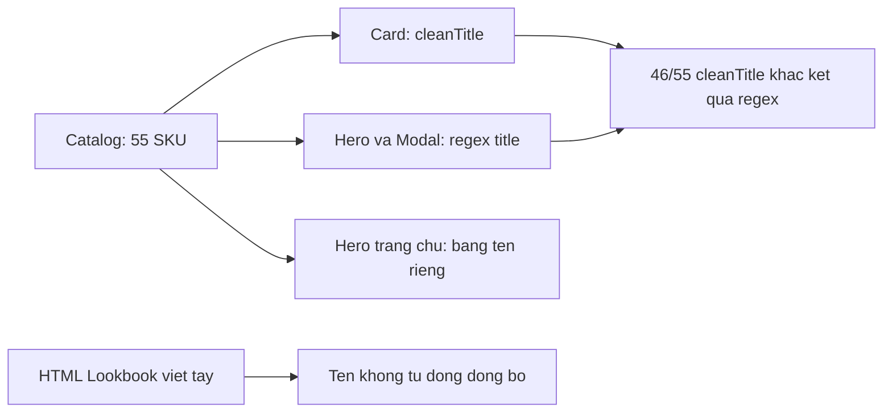
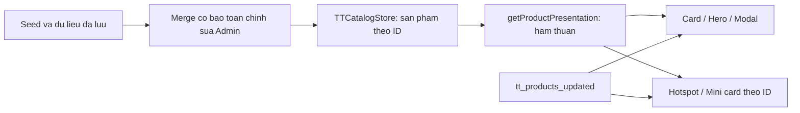

# BẢN CHỈ THỊ PHÊ DUYỆT KIẾN TRÚC & MÃ NGUỒN CHI TIẾT

**Mã:** TT3D-STUDIO-TYPO-R1 / MASTER-REVISION-1  
**Ngày:** 31/10/2026  
**Quyết định:** Phê duyệt triển khai sau khi điều chỉnh theo tài liệu này. Chưa nghiệm thu sản phẩm.  
**Đầu vào:** CODEX_BRIDGE do người dùng truyền trong stdin. Không coi báo cáo của Worker là kết quả kiểm chứng độc lập.

## 1. Phạm vi và bằng chứng

Đích triển khai là storefront tĩnh `index.html`, `js/`, `css/`, `products.json`, đóng gói bằng `npm run build:static`. Không chuyển sang Next.js hoặc thay kiến trúc giỏ hàng trong đợt typography này.

Snapshot đã đọc: HEAD `6790c4eb11df9e7dd698ea9825a8699a89be00a8`, kèm working tree đang có nhiều thay đổi. Đặc biệt `css/catalog.css` đang untracked; không được bỏ qua khi bàn giao diff. Giữ nguyên các thay đổi không thuộc phạm vi. Đây không phải kiểm toán toàn bộ kho mã.

| Bằng chứng | Kết luận / chỉ thị |
| --- | --- |
| `products.json`: 55/55 sản phẩm có `cleanTitle`; 46/55 khác kết quả regex hiện tại trên `title` | Sửa regex đơn lẻ không giải quyết nguyên nhân. Cần một bộ phân giải tên dùng chung. |
| `js/products-manager.js:217`: card dùng `cleanTitle`; dòng 256 và 847: Hero/Modal dùng `getCleanTitle(item.title)` | Có thể cùng một SKU hiện hai tên khác nhau. Đồng bộ bằng cùng một hàm. |
| `js/app.js:554`: có bảng tên Hero viết riêng theo ID | Bỏ bảng tên này sau khi nối vào nguồn chung. |
| `index.html`: Lookbook/hotspot chứa tên viết trực tiếp; modal thực tế là `#order-modal`, tên là `#order-prod-title` | WP-3 trong bridge dùng selector giả định. Worker phải sửa các điểm chạm thực tế. |
| `css/catalog.css:64,122`: desktop 16px, mobile 13px; tiêu đề clamp 2 dòng; benefit clamp 1 dòng | Cần sửa cả quy tắc mobile và cơ chế cắt chữ, không chỉ khai báo desktop mới. |
| `js/catalog-store.js:409-435`: dữ liệu đã lưu đè lên seed | Đổi `products.json` đơn thuần không bảo đảm người dùng cũ nhận tên mới. |
| `js/catalog-store.js:345-387`: sanitizer giữ `specs` là object và chỉ cho qua các trường định danh sẵn có | Không đổi `specs` sang array hoặc tự thêm `subtitle` vào JSON mà không xử lý contract. |
| `index.html:13`, `css/style.css:51-53` | Plus Jakarta Sans và JetBrains Mono đã được tải/cấu hình. Không bổ sung font request trùng. |

Đã xem ảnh lưu `reports/catalog-ux-2026-10-30/after-mobile.png` như tư liệu tham chiếu: tên dày, dài và cắt ở lưới hai cột. Đây là ảnh cũ, không phải ảnh nghiệm thu phiên hiện tại. Ảnh sản phẩm đầu có hình dạng ống/bình trong khi `cleanTitle` gọi là khay; phải đối chiếu ảnh và nguồn từng SKU trước khi chốt danh từ.

Chưa chạy ứng dụng, baseline test hoặc browser trong phiên thẩm định này. Đếm được **19 tệp test**, không có căn cứ gọi là “19 bài test PASS”. Không có công cụ Chrome DevTools/Argon callable được phát hiện trong danh mục công cụ phiên này; không giả lập kết quả hội ý hoặc hạn mức tài khoản. Bản đề xuất của Antigravity và bản phản biện này là hai góc đánh giá; Worker kiểm chứng bằng dữ liệu và ảnh trước/sau.

## 2. Quyết định thiết kế

Phê duyệt phong cách **Atelier đương đại**: tên dễ nhận ra vật thể, ảnh sản phẩm là trọng tâm, nhịp chữ thoáng, một chi tiết monospace và một sắc đất nung làm dấu hiệu nhận diện.

Không phê duyệt các phần sau trong bridge:

- Xóa mọi nội dung trong ngoặc bằng regex: có thể làm mất kích thước, biến thể hoặc công năng thật.
- Tự sáng tác tên bằng thuật toán, đổi SKU, hoặc chuyển mô tả marketing thành danh từ sản phẩm sai loại.
- Hiển thị `SERIES 01`, “Mới ra mắt”, `0.12MM`, NFC, vật liệu hay số màu khi chưa có nguồn dữ liệu xác minh.
- Dùng emoji và nhiều badge trang trí đồng thời trên mỗi card. Mỗi thông tin xuất hiện một lần; màu sắc không phải dấu hiệu duy nhất.
- `href="javascript:void(0)"` để mở modal. Đây là hành động của button.
- Nhận định có một quy chuẩn tiếng Việt bắt buộc mọi tiêu đề phải dùng `line-height: 1.45–1.55` hoặc tracking âm. Các giá trị là lựa chọn thiết kế cần kiểm chứng trên font và bố cục cụ thể.

Luồng hiện tại:



Luồng được phê duyệt:



## 3. WP-0: Chốt baseline trước khi sửa

1. Ghi trạng thái Git, HEAD, danh sách file dự kiến thay đổi vào `reports/typography-r1/verification.md`.
2. Chụp trang hiện tại ở 390 và 1440 CSS px, catalog lưới hai cột/ảnh lớn, Hero và modal cùng một SKU. Ghi route, viewport, theme, storage mới/cũ. Chỉ ghi kết quả thật.
3. Lưu baseline seed trước chỉnh sửa, tối thiểu `{id, title, cleanTitle}` cho 55 SKU; dùng làm dữ liệu so sánh migration.
4. Chạy 19 tệp test hiện có để biết lỗi nền. Bổ sung ca lỗi tên khác nhau giữa card/Hero/modal; ca tên bị cắt trên mobile. Không sửa test để hợp thức hóa lỗi nền.
5. Thử nghiệm ngắn: cho card/Hero/modal đọc cùng `cleanTitle` trên cùng SKU và tạm bỏ clamp. So sánh textContent và ảnh. Nếu tên vẫn sai vật thể, sửa nội dung của SKU; nếu chữ vẫn nhỏ, kiểm tra computed style và cascade. Hai nguyên nhân được kiểm tra riêng.

## 4. WP-1: Contract tên dùng chung

Chủ sở hữu là `js/catalog-store.js`. Thêm hàm thuần `getProductPresentation(product)` vào API `window.TTCatalogStore`. Không thêm framework, font hoặc thư viện runtime. API trả text thuần, không trả HTML, không ghi storage, không sửa đối tượng đầu vào.

Contract:

```js
// Giá trị suy ra để render; không thay schema persistence của product.
{
  title: 'Ống cắm cọ Nơ Lụa',
  subtitle: 'Sắp gọn cọ trang điểm và góc bàn.',
  categoryLabel: 'Trang Điểm & Nơ Lụa',
  specs: ['90g'] // mảng phục vụ view, KHÔNG phải product.specs
}
```

Mã lõi tham chiếu được phê duyệt, đặt trong IIFE hiện có. Worker điều chỉnh tên helper để không trùng khai báo; giữ các quy tắc hành vi bên dưới:

```js
function presentationText(value) {
  return typeof value === 'string'
    ? value.normalize('NFC').replace(/\s+/gu, ' ').trim()
    : '';
}

function fallbackProductTitle(value) {
  const original = presentationText(value);
  // Chỉ bỏ hậu tố mã importer đúng mẫu; bảo toàn nội dung trong ngoặc.
  const withoutImporterId = original
    .replace(/\s*#MW-\d+\s*$/iu, '')
    .trim();
  return withoutImporterId || original;
}

function getProductPresentation(product) {
  const p = product && typeof product === 'object' ? product : {};
  const title = presentationText(p.cleanTitle)
    || fallbackProductTitle(p.title)
    || 'Sản phẩm T&T';
  const categoryLabel = presentationText(
    CATEGORY_REGISTRY[p.category]?.shortName
  ) || 'Thiết kế T&T';
  const sourceSpecs = p.specs && typeof p.specs === 'object'
    && !Array.isArray(p.specs) ? p.specs : {};
  const specs = [...new Set(
    ['material', 'layer', 'dimensions', 'weight']
      .map(key => presentationText(sourceSpecs[key]))
      .filter(Boolean)
  )].slice(0, 2);
  return {
    title,
    subtitle: presentationText(p.headlineBenefit),
    categoryLabel,
    specs
  };
}

// Bổ sung getProductPresentation vào object export hiện có.
```

Các giá trị specs trên chỉ được xuất bản sau khi audit nguồn dữ liệu. Sự tồn tại của chuỗi trong seed chưa chứng minh thông số là đúng. Nếu chưa xác minh được, bỏ thông số khỏi dữ liệu trình bày; không dùng fallback marketing. `materialRecommendation` là khuyến nghị, không được tự trình bày như vật liệu đã chọn. Số màu chỉ tính từ tùy chọn hợp lệ theo validator hiện có. Không tách `microSpecs` tùy tiện bằng dấu cách để chế tạo badge.

Giữ `title`, `originalTitle`, ID, modelId và tên gốc để tìm kiếm/truy xuất. `getCleanTitle` không còn là một chính sách đặt tên cạnh tranh. Thay các call site bằng API chung; chỉ giữ wrapper tạm nếu đã xác minh còn caller cần tương thích.

## 5. WP-1B: Biên tập tên và migration

Quy tắc biên tập: **loại vật thể + đặc điểm phân biệt + tên bộ sưu tập/tên riêng khi cần**. Ưu tiên sentence case và 4–8 từ, không cắt chuỗi tự động để ép số từ. Giữ tên riêng; không thêm công năng, vật liệu hoặc mức độ “cao cấp” chưa được kiểm chứng. Bảo toàn sự khác nhau của các biển đỗ xe, clicker và biến thể gần giống.

Bảng định hướng cần đối chiếu ảnh/nguồn trước khi ghi `cleanTitle`:

| SKU | Tên ngắn đề nghị |
| --- | --- |
| `mw-cn-2084928` | Ống cắm cọ Nơ Lụa |
| `mw-cn-1646129` | Khay trang sức Nơ Lụa |
| `mw-cn-1954833` | Đèn tam giác Vân Dệt |
| `mw-cn-1702306` | Rắn khớp động Gary |
| `mw-cn-2332220` | Hộp nhẫn Vỏ Sò |

“Vân dệt” mô tả hình dáng bề mặt; không biến vật in 3D thành sản phẩm làm bằng len. Lập bảng trước/sau cho tất cả SKU được đổi, kèm lý do. Nếu thiếu bằng chứng xác định loại vật thể, giữ tên mô tả đúng đã có thay vì đổi theo suy đoán.

Cập nhật seed phải đi cùng đường nâng cấp người dùng cũ. Áp dụng three-way merge rất hẹp:

```text
với SKU có trong baseline cũ VÀ seed mới:
  nếu raw.title == baseline.title
     VÀ raw.cleanTitle == baseline.cleanTitle:
       cập nhật riêng cleanTitle bằng seed mới
  ngược lại: giữ raw.cleanTitle
tiếp tục merge/sanitize bằng luồng hiện có
```

Baseline cũ là snapshot bất biến đã chụp trước khi biên tập, không được dựng từ seed đã sửa. Có thể sinh hằng map `{id: {title, cleanTitle}}` trong module store để runtime không cần fetch thêm file. Tên mới chỉ lấy từ seed mới, không duy trì bảng tên mới thứ hai. Bản ghi được Admin đánh dấu sửa riêng phải được giữ; Worker kiểm tra cơ chế provenance hiện có. Nếu không có dấu vết phân biệt, chỉ coi giá trị trùng hoàn toàn baseline là dữ liệu seed đủ điều kiện nâng cấp, ghi rõ giới hạn này trong báo cáo.

Không cập nhật giá, biến thể, `specs`, custom text, `modelKey:null`, tombstones hoặc mảng rỗng có chủ ý. Không clear localStorage, không ép reset 55 SKU. Fetch lỗi/offline thì dùng dữ liệu đã lưu và không đánh dấu migration thành công. Migration phải idempotent. Chỉ tăng catalog revision khi thay seed và đã bổ sung kiểm tra tương thích; không tăng schema version chỉ để đổi nội dung tên. Nếu biên tập cả `headlineBenefit`, phải dùng so sánh baseline riêng cho trường đó, không ghi đè toàn bộ sản phẩm.

## 6. WP-2: Product card và CSS

Thứ tự: ảnh → category nhỏ → tên → một câu công năng ngắn nếu có → tối đa hai thông tin thật → màu/giá/CTA. Không đặt thông số kỹ thuật phía trên tên. Chỉ hiển thị badge khi đủ điều kiện; không lặp cùng badge ở ảnh và header.

Mẫu tích hợp trong `buildProductCardHTML`:

```js
const view = window.TTCatalogStore.getProductPresentation(item);
// Giữ sanitizer URL và các phần giá/biến thể/CTA hiện có.
// escapeHTML được dùng ở mọi vị trí text và thuộc tính động.
```

```html
<h3 class="catalog-product-title tt-product-name">
  <button type="button" class="catalog-title-button"
          data-action="open-detail" data-product-id="ID_DA_ESCAPE">
    TEN_DA_ESCAPE
  </button>
</h3>
```

Đưa button vào bộ event delegation có sẵn. Không thêm onclick động, không bọc toàn card trong button, không tạo ID trùng. Tên nút đủ mô tả SKU. Giữ focus khi mở/đóng modal và điều khiển được bằng Enter/Space.

Các giá trị CSS cơ sở được phê duyệt; thay tại quy tắc đang sở hữu component, không nối thêm nhiều lớp override. Đặc biệt xóa/đổi khai báo mobile `font-size:13px`, `min-height:39px` và clamp cũ:

```css
#store-catalog .catalog-product-card {
  --product-ink: #141413;
  --product-muted: #68615b;
  --product-accent: #a4472a;
}

#store-catalog .catalog-product-title {
  display: block;
  margin: 0;
  min-block-size: 3em;
  max-block-size: none;
  overflow: visible;
  -webkit-line-clamp: unset;
  font-family: var(--font-sans);
  font-size: clamp(.9375rem, .9rem + .15vw, 1.0625rem);
  line-height: 1.5;
  font-weight: 650;
  letter-spacing: -.01em;
  text-align: start;
  text-wrap: pretty;
  overflow-wrap: anywhere;
  color: var(--product-ink);
}

#store-catalog .catalog-title-button {
  display: block;
  width: 100%;
  padding: 0;
  border: 0;
  background: transparent;
  color: inherit;
  font: inherit;
  letter-spacing: inherit;
  text-align: inherit;
  white-space: normal;
  cursor: pointer;
  transition: color 180ms ease;
}

#store-catalog .catalog-title-button:hover,
#store-catalog .catalog-title-button:focus-visible {
  color: var(--product-accent);
  text-decoration: underline;
  text-underline-offset: .2em;
}

#store-catalog .catalog-title-button:focus-visible {
  outline: 2px solid var(--product-accent);
  outline-offset: 3px;
  border-radius: 2px;
}

#store-catalog .catalog-product-category {
  font: 500 .6875rem/1.6 var(--font-mono);
  letter-spacing: .04em;
  color: var(--product-muted);
}

@media (prefers-reduced-motion: reduce) {
  #store-catalog .catalog-title-button { transition: none; }
  #store-catalog .catalog-product-card { transition: none; transform: none; }
  #store-catalog .catalog-product-card:hover { transform: none; }
  #store-catalog .catalog-product-photo img { transition: none; transform: none; }
  #store-catalog .catalog-product-card:hover .catalog-product-photo img {
    transform: none;
  }
}
```

Kiểm tra file font thực tải có weight 650/variable; nếu chỉ có static weight, dùng 600 hoặc 700 đang có, không tải thêm chỉ vì weight này. `text-wrap:pretty` chỉ là cải thiện tăng thêm; layout phải dùng được khi trình duyệt bỏ qua. Các container cha phải cho phép tên tăng chiều cao và không cắt focus outline. Giữ footer card căn dưới bằng flex hiện có, không ép chiều cao card cố định. Với tên dài ba dòng trên mobile, cho card tăng chiều cao.

Không bắt buộc `letter-spacing:-.02em`; trên chữ Việt nhỏ ưu tiên -.01em hoặc 0 sau kiểm tra. Monospace phục vụ category/metadata, không dùng cho tên tiếng Việt dài. Giữ category bình thường thay vì uppercase toàn bộ tiếng Việt.

Màu `#C85A32` có thể dùng cho chi tiết trang trí. Không dùng cho chữ 15–17px trên nền sáng: đo theo công thức tương phản cho kết quả 4.230:1 trên trắng và 3.990:1 trên `#FAF8F5`. `#A4472A` tương ứng 5.977:1 và 5.639:1; dùng màu này cho chữ tương tác trên hai nền đó. Không suy rộng kết quả sang nền khác/dark mode; đo trên computed colors thực tế.

Nếu có dark mode, token chữ phải theo nền thật của từng surface. Các token catalog trên áp cho card trắng hiện tại; Hero/Modal dùng token của surface tương ứng, không sao chép màu than lên nền tối.

## 7. WP-3: Đồng bộ điểm chạm

| Vị trí | Công việc |
| --- | --- |
| Catalog card và Category Hero trong `js/products-manager.js` | Cùng lấy `view.title`; thay cả aria-label/alt fallback có dùng tên. Không ghi đè imageAlt mô tả ảnh hợp lệ. |
| `#hero-showcase-title` trong `js/app.js` | Bỏ bảng tên riêng ở dòng 554; dùng cùng API; bỏ `truncate` nếu đang cắt tên. Giữ cơ chế chống race khi đổi ảnh/tab. |
| `#order-prod-title` trong `#order-modal` | Gán bằng textContent từ API; tiêu đề không clamp, kiểm tra font/leading thực tế. Giữ aria-labelledby và focus return. |
| Hotspot khu Shop the Look và mini card ở VIEW 3 của `index.html` | Đánh dấu slot bằng `data-product-title="SKU"`; resolve theo catalog sau init và sau `tt_products_updated`. Không giữ tên mới trong HTML, bảng tên JS và seed đồng thời. |
| Các nhãn truy cập | Đồng bộ aria-label có chứa tên; giữ các nhãn mô tả khác phù hợp ngữ cảnh. |

Hàm đồng bộ slot phải idempotent, đăng ký listener một lần. Với SKU không tồn tại hoặc không còn active: không dựng tên giả, không tạo sản phẩm mới; bỏ hành động mua/xem tương ứng theo trạng thái không khả dụng. Kiểm tra cả dữ liệu sau `getProducts()` và cập nhật từ Admin/tab khác. Có text fallback dễ hiểu trước khi init để tránh ô trống không giải thích.

Các combo đang có tên/giá hardcode phải được liệt kê trong báo cáo. Trong phạm vi R1, không thêm snapshot tên mới vào các handler đó. Nếu đổi luồng combo, chỉ resolve SKU hiện hành qua pipeline giỏ/cấu hình sẵn có và bổ sung test lựa chọn biến thể; không nhân tiện viết lại cart hoặc sửa lịch sử đơn hàng. Giá và lựa chọn vẫn phải đúng SKU sau đổi tên.

Xóa fallback thông số không có chứng cứ trong phần Hero được sửa, ví dụ `Kích thước chuẩn`, `Nhẹ bền`, `Bio-PLA Cao Cấp` ở `products-manager.js:259-263`. Modal đang có HUD suy từ category ở dòng 829-840: kiểm tra và ẩn các giá trị chưa xác minh thay vì tô lại giao diện cho chúng. Không dùng category để khẳng định SKU có chip NFC.

## 8. WP-4: Kiểm chứng bắt buộc

### 8.1. Test hành vi

Thêm `tests/test_product_presentation.js` theo Node/assert hiện có, kiểm tra hàm thật và các call site thực thi; không chỉ tìm chuỗi trong file:

1. Ưu tiên cleanTitle, fallback khi rỗng/khoảng trắng; null/sai kiểu không crash; không ra `[object Object]`.
2. Bảo toàn `Đèn (size L)`, `Biển tên (2 dòng)`, tên chỉ có trong ngoặc; chỉ bỏ mã importer đúng hậu tố.
3. NFC/NFD hiển thị nhất quán; không thay dấu hoặc title-case tiếng Việt bằng thuật toán ASCII.
4. Payload ``, dấu nháy và ký tự `&` được xem là text, không tạo node/script hoặc phá thuộc tính.
5. Cùng SKU có cùng tên trên card, Category Hero, Home Hero, modal và Lookbook; sau cập nhật catalog cũng đồng bộ.
6. Thiếu specs không tạo layer height/material/NFC/series/new badge; product.specs vẫn là object.
7. Migration nâng tên seed cũ, giữ tên Admin đã sửa, giữ tombstone/[]/modelKey:null; fetch lỗi không ghi revision mới; chạy lần hai không tiếp tục đổi dữ liệu.
8. Search vẫn tìm tên gốc/model ID; thay tên không làm đổi giá/biến thể/SKU của lựa chọn mua.

Đối chứng: ca so sánh tên phải phát hiện được snapshot trước sửa; test migration phải thất bại nếu thay bằng ghi đè seed toàn bộ. Không viết test chỉ lặp thuật toán implementation. Với thay đổi chữ/spacing nhỏ, dùng kiểm tra browser và ảnh thay vì cố định mọi giá trị CSS trong unit test.

### 8.2. Các lệnh

Chạy cú pháp những file JS đã thay đổi bằng `node --check <file>`. Repo hiện không có script `npm test`; không tự báo đã chạy lệnh không tồn tại.

Chạy từng tệp test và kiểm tra exit code. Ví dụ PowerShell, lưu toàn bộ log trong thư mục báo cáo:

```powershell
$failedTests = @()
foreach ($testFile in Get-ChildItem -LiteralPath tests -Filter '*.js' -File) {
  & node $testFile.FullName
  if ($LASTEXITCODE -ne 0) { $failedTests += $testFile.Name }
}
if ($failedTests.Count -gt 0) {
  throw ('Test failed: ' + ($failedTests -join ', '))
}
```

Sau khi sửa và kiểm tra đạt, chạy `npm run build:static`. Kiểm tra manifest và bundle có CSS/JS/seed mới. Không thay file trực tiếp trong `dist/`. Đồng bộ cache-busting của tài nguyên đã đổi ở các HTML sử dụng chúng, gồm admin nếu store API/migration đổi. Chạy smoke/visual trên server phục vụ **dist**, không chỉ repo root. Build fail thì không gọi bản phát hành là sẵn sàng.

### 8.3. Nghiệm thu trình duyệt

- Viewport: 320, 390, 768 và 1440 CSS px; compact và large; light/dark nếu hỗ trợ. Kiểm tra tất cả 55 SKU và các tên dài nhất.
- Không cắt dấu ở trên/dưới, tên đọc trọn, không overflow ngang của trang hoặc card. Không dùng tooltip `title` thay cho tên bị cắt.
- Kiểm tra 200% zoom, reflow tương đương 320 CSS px; text spacing override: line-height 1.5, paragraph spacing 2em, letter-spacing .12em, word-spacing .16em, không mất nội dung/chức năng.
- Chụp sau `document.fonts.ready`; kiểm tra rendered font thực sự cho `Ắ Ằ Ẳ Ẵ Ặ Ế Ề Ể Ễ Ệ Ố Ộ Ở Ỡ Ự` và chữ thường. Kiểm tra thêm fallback khi chặn font request. `document.fonts.ready` riêng lẻ không chứng minh có đủ glyph.
- Keyboard: title button mở đúng SKU bằng Enter/Space; focus rõ, Esc đóng, trả focus về trigger; không có nested button. Bảo toàn hành vi hotspot đang có.
- Hover chỉ tăng phản hồi; touch vẫn nhận diện rõ hành động. Reduced motion không còn dịch/zoom component được sửa.
- Lưu console errors, network failures, computed font/size/line-height/colors, screenshot trước/sau cùng điều kiện. Phân biệt lỗi ứng dụng mới với lỗi mạng ngoại vi đã có.
- Nếu không có Chrome DevTools MCP, dùng browser automation/headless đã có trong môi trường và ghi đúng công cụ; thiếu browser evidence thì đánh dấu chưa nghiệm thu visual.

## 9. Tài liệu kỹ thuật đã đối chiếu

Đây là nguồn kỹ thuật phục vụ quyết định, không phải tuyên bố đã tìm “tất cả tài liệu” hoặc có một công thức thẩm mỹ tối ưu tuyệt đối:

1. [W3C — Text Spacing](https://www.w3.org/WAI/WCAG22/Understanding/text-spacing.html): phải chịu được việc người dùng thay spacing; không bắt buộc tất cả nội dung mặc định dùng line-height 1.5.
2. [W3C — Contrast Minimum](https://www.w3.org/WAI/WCAG22/Understanding/contrast-minimum.html): chữ thường tối thiểu 4.5:1, chữ lớn 3:1; tên 17px bold chưa thuộc ngưỡng chữ lớn của tiêu chí.
3. [Google Fonts — Diacritic Marks](https://googlefonts.github.io/gf-guide/diacritics.html): vị trí/khoảng cách dấu và dấu ghép là vấn đề của font/shaping, không giải quyết chỉ bằng tăng line-height.
4. [Tokotype — Plus Jakarta Sans](https://github.com/tokotype/PlusJakartaSans): nguồn gốc font đang dùng. Không suy diễn repo này ban hành các giá trị spacing trong bridge.
5. [JetBrains — Mono](https://www.jetbrains.com/lp/mono/): nguồn thiết kế font mono, phù hợp tham chiếu metadata. Không chứng minh 10px uppercase là tối ưu cho tiếng Việt.
6. [W3C APG — Button](https://www.w3.org/WAI/ARIA/apg/patterns/button/): button kích hoạt hành động/dialog và tương tác bàn phím.
7. [MDN — text-wrap](https://developer.mozilla.org/en-US/docs/Web/CSS/Reference/Properties/text-wrap): hành vi thuộc tính wrap; không phụ thuộc nó để bảo đảm nội dung đọc được.

Kinfolk/Aesop/Vitra/Hay/Teenage Engineering trong bridge được coi là tham chiếu cảm hứng chưa có tài liệu dẫn chứng cụ thể. Không ghi như nguồn ban hành tiêu chuẩn kỹ thuật.

## 10. Điều kiện bàn giao

Antigravity được triển khai ngay WP-0 → WP-1/1B → WP-2 → WP-3 → WP-4, không cần xin duyệt lại các lựa chọn đã chốt trong phạm vi này. Dừng mở rộng sang thiết kế lại toàn website, thêm engine, thay cart hoặc đổi sản phẩm ngoài danh sách có bằng chứng.

Nộp lại: diff theo file; bảng tên trước/sau; baseline và kết quả migration; số test thực tế và exit code; build log/manifest; screenshot gốc và dist; lỗi còn lại; giới hạn dữ liệu chưa xác minh. Lỗi nền phải báo riêng, không gọi là xanh toàn bộ.

Chỉ đề nghị nghiệm thu khi tên cùng SKU đồng nhất ở mọi điểm chạm, đọc đủ trên mobile, dữ liệu Admin được bảo toàn, không thêm thông số giả và mọi kiểm tra liên quan có bằng chứng. **Phê duyệt kiến trúc không đồng nghĩa xác nhận mã đã được sửa hoặc website đã đạt.**
